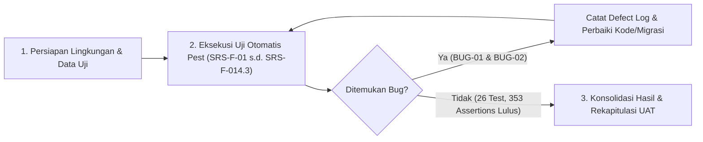

# Dokumen Pengujian Perangkat Lunak — RanggaMotret.id

Dokumen ini berisi **Rencana Pengujian (*Test Plan*)**, **Kategori Pengujian (*Test Categories*)**, dan **Pelaksanaan Pengujian (*Test Execution Specification & Results*)** untuk sistem informasi layanan jasa fotografi dan akademi online **RanggaMotret.id**. Seluruh butir uji disusun mengacu pada spesifikasi kebutuhan perangkat lunak (**SRS-F-01 s.d. SRS-F-014.3**) dan telah dieksekusi menggunakan **Pest PHP** pada **15 November 2026** terhadap basis kode aktual (*Unified Adaptive Dashboard* & *MVC Robustness Architecture*).

---

## Daftar Isi
- [Bagian I — Rencana Pengujian (*Test Plan*)](#bagian-i--rencana-pengujian-test-plan)
  - [1. Tujuan & Ruang Lingkup](#1-tujuan--ruang-lingkup)
  - [2. Aktor Sistem & Matriks Hak Akses](#2-aktor-sistem--matriks-hak-akses)
  - [3. Lingkungan & Konfigurasi Pengujian](#3-lingkungan--konfigurasi-pengujian)
  - [4. Alur & Kriteria Pengujian](#4-alur--kriteria-pengujian)
  - [5. Matriks Ketertelusuran (*Requirements Traceability Matrix / RTM*)](#5-matriks-ketertelusuran-requirements-traceability-matrix--rtm)
- [Bagian II — Kategori Pengujian (*Test Categories*)](#bagian-ii--kategori-pengujian-test-categories)
- [Bagian III — Pelaksanaan Pengujian & Hasil Eksekusi (*Test Execution*)](#bagian-iii--pelaksanaan-pengujian--hasil-eksekusi-test-execution)
  - [1. Prosedur, Data Uji & Konvensi Status](#1-prosedur-data-uji--konvensi-status)
  - [2. Skenario, Hasil Aktual & Status Kasus Uji (`SRS-F-01` s.d. `SRS-F-014.3`)](#2-skenario-hasil-aktual--status-kasus-uji-srs-f-01-sd-srs-f-0143)
  - [3. Ringkasan Eksekusi Uji Otomatis (`php artisan test`)](#3-ringkasan-eksekusi-uji-otomatis-php-artisan-test)
  - [4. Catatan Temuan Bug & Perbaikan (*Defect Log*)](#4-catatan-temuan-bug--perbaikan-defect-log)
  - [5. Rekapitulasi Akhir Hasil Pengujian](#5-rekapitulasi-akhir-hasil-pengujian)

---

# Bagian I — Rencana Pengujian (*Test Plan*)

## 1. Tujuan & Ruang Lingkup
Pengujian bertujuan memverifikasi bahwa seluruh fungsi bisnis pada aplikasi **RanggaMotret.id** berjalan sesuai kebutuhan fungsional **SRS-F-01** hingga **SRS-F-014.3**, bebas dari galat logika validasi, serta menjaga isolasi hak akses antar-peran (*Role-Based Access Control*).

**Ruang lingkup pengujian meliputi:**
1. **Autentikasi & Akun (`SRS-F-01` – `SRS-F-04`)**: Registrasi pelanggan terpadu, login/logout, pengelolaan profil, dan pengamanan akun nonaktif.
2. **Manajemen Konten Publik & Akademi (`SRS-F-05` – `SRS-F-07`, `SRS-F-013`)**: Katalog layanan & paket fotografi, manajemen kursus, manajemen modul/materi/kuis evaluasi, ruang belajar LMS, dan portofolio album foto.
3. **Transaksi Inti & Penjadwalan (`SRS-F-08` – `SRS-F-011`)**: Reservasi fotografi (beserta deteksi bentrok slot jam dan proofing hasil foto), reservasi/pendaftaran kursus, kalender jadwal interaktif (`FullCalendar`), integrasi pembayaran **Midtrans Snap**, webhook callback (verifikasi *SHA512 signature*), serta penerbitan invoice resmi.
4. **Layanan Klien & Pelaporan Eksekutif (`SRS-F-012`, `SRS-F-014`)**: Konsultasi konsep dua arah antara pelanggan dan owner, laporan pendapatan, laporan reservasi/kursus, serta ekspor dokumen **PDF (DomPDF)** dan **Excel `.xlsx` (PhpSpreadsheet)**.

## 2. Aktor Sistem & Matriks Hak Akses
Sistem menerapkan arsitektur *Unified Adaptive Dashboard* (`/dashboard`) dengan **2 aktor utama** (**Pelanggan** dan **Owner**, ditambah sistem eksternal **Midtrans Gateway** untuk notifikasi *webhook* pembayaran):

| Aktor / Entitas | Role Database | Hak Akses Utama yang Diuji |
| :--- | :--- | :--- |
| **Pelanggan** | `pelanggan` | Akses halaman publik sebelum login (Beranda, Katalog Layanan, Katalog Kursus, Portofolio, Verifikasi Sertifikat, Registrasi & Login), Dasbor terpadu pelanggan/siswa, Profil, Buat & Lihat Reservasi Foto, Proofing Foto, Daftar Kursus, LMS Ruang Belajar & Kuis, Kalender Jadwal Pribadi, Pembayaran & Invoice, Pengajuan, Riwayat & Balas Konsultasi. |
| **Owner** | `owner` | Dasbor eksekutif, CRUD Katalog/Paket/Kategori, CRUD Kursus/Modul/Materi/Kuis, Kelola & Konfirmasi Reservasi Foto/Kursus, Upload Proofing, Kelola & Reschedule Kalender Jadwal, Verifikasi Pembayaran, Respon Konsultasi, CRUD Portofolio, Laporan & Ekspor PDF/Excel. |
| **Midtrans Gateway** | *(Webhook API)* | Mengirim notifikasi status transaksi (`settlement`, `capture`, `pending`, `deny`, `expire`, `cancel`) ke endpoint `POST /payments/midtrans-callback`. |

## 3. Lingkungan & Konfigurasi Pengujian

| Komponen | Spesifikasi Aktual Lingkungan Uji |
| :--- | :--- |
| **Framework & Bahasa** | Laravel Framework `13.24.0`, PHP `8.5.6` (CLI Windows) |
| **Basis Data Uji Otomatis** | SQLite `:memory:` dengan `RefreshDatabase` & *foreign key constraints* aktif ([phpunit.xml](../phpunit.xml)) |
| **Payment Gateway** | Midtrans Snap Sandbox (`MIDTRANS_IS_PRODUCTION=false`) + Verifikasi SHA512 lokal ([MidtransService.php](../app/Services/MidtransService.php)) |
| **Library Pendukung** | `barryvdh/laravel-dompdf`, `phpoffice/phpspreadsheet`, `midtrans/midtrans-php`, FullCalendar `6.1.10`, Alpine.js 3, Tailwind CSS, Phosphor Icons `2.1.1` |
| **Alat & Skrip Uji Otomatis** | Pest PHP `^5.0` — [SrsComprehensiveTest.php](../tests/Feature/SrsComprehensiveTest.php), [RobustnessMvcArchitectureTest.php](../tests/Feature/RobustnessMvcArchitectureTest.php), [UnifiedCustomerTest.php](../tests/Feature/UnifiedCustomerTest.php) |

## 4. Alur & Kriteria Pengujian



- **Kriteria Masuk (*Entry Criteria*)**: Seluruh modul `SRS-F-01` s.d. `SRS-F-014.3` telah diimplementasikan pada cabang `main` dan konfigurasi testing ([phpunit.xml](../phpunit.xml)) siap.
- **Kriteria Keluar (*Exit Criteria*)**:
  1. Seluruh skenario uji otomatis Pest (`php artisan test`) lulus tanpa *error* atau *skipped assertion* (pasca-perbaikan temuan bug).
  2. Batas cakupan antara pengujian terotomasi (HTTP, Controller, Model, Webhook, PDF/Excel) dan pengujian UAT browser interaktif (interaksi klik mouse langsung & *popup* `snap.js` Midtrans Sandbox) terdokumentasi secara transparan.

## 5. Matriks Ketertelusuran (*Requirements Traceability Matrix / RTM*)

| No. SRS | ID Uji | Kebutuhan Fungsional | Butir Uji | Kasus Uji | Control (Controller) | Boundary (Route Utama) | Entity (Model) |
| :--- | :--- | :--- | :--- | :--- | :--- | :--- | :--- |
| `SRS-F-01` | `TC-F-01.1` | Registrasi | Registrasi Akun Pelanggan Valid & Login Otomatis | `POST /register` dengan `name`, `email` unik, `phone`, `password` (`rahasia123`) & konfirmasi cocok. | [AuthController](../app/Http/Controllers/AuthController.php#L44-L84) | `GET/POST /register` | `User`, `Customer` |
| `SRS-F-01` | `TC-F-01.2` | Registrasi | Penolakan Registrasi Email Duplikat | `POST /register` menggunakan email yang sudah terdaftar. | [AuthController](../app/Http/Controllers/AuthController.php#L44-L84) | `POST /register` | `User` |
| `SRS-F-01` | `TC-F-01.3` | Registrasi | Validasi Panjang Minimum & Konfirmasi Password | `POST /register` dengan `password` `< 8` karakter (`12345`) & konfirmasi tidak cocok (`54321`). | [AuthController](../app/Http/Controllers/AuthController.php#L44-L84) | `POST /register` | `User` |
| `SRS-F-02` | `TC-F-02.1` | Login | Otentikasi Login Kredensial Valid Pelanggan & Owner | `POST /login` kredensial valid milik `pelanggan` & `owner`, lalu akses `/dashboard`. | [AuthController](../app/Http/Controllers/AuthController.php#L13-L42) | `GET/POST /login`, `GET /dashboard` | `User` |
| `SRS-F-02` | `TC-F-02.2` | Login | Penolakan Login dengan Password Salah | `POST /login` dengan password salah. | [AuthController](../app/Http/Controllers/AuthController.php#L13-L42) | `POST /login` | `User` |
| `SRS-F-02` | `TC-F-02.3` | Login | Penolakan Akun Nonaktif & Proteksi Rute `RoleMiddleware` | `POST /login` akun ber-`status = 'inactive'` dan uji `RoleMiddleware` pada `/reservasi`. | [AuthController](../app/Http/Controllers/AuthController.php#L13-L42), [RoleMiddleware](../app/Http/Middleware/RoleMiddleware.php) | `POST /login`, `GET /reservasi` | `User` |
| `SRS-F-03` | `TC-F-03.1` | Logout | Terminasi Sesi Pengguna & Pemblokiran Akses Dasbor | Klik keluar (`POST /logout`), lalu akses `/dashboard`. | [AuthController](../app/Http/Controllers/AuthController.php#L86-L92) | `POST /logout`, `GET /dashboard` | `User` |
| `SRS-F-04.1` | `TC-F-04.1` | Lihat Profil | Tampilan Halaman Profil Pengguna Aktif | Akses halaman `GET /profile`. | [ProfileController](../app/Http/Controllers/ProfileController.php#L21-L25) | `GET /profile` | `User` |
| `SRS-F-04.2` | `TC-F-04.2` | Ubah Profil | Pembaruan Biodata & Sinkronisasi Tabel `customers` | `POST /profile` ubah `name`, `phone`, `address` (tanpa ganti password). | [ProfileController](../app/Http/Controllers/ProfileController.php#L30-L61) | `POST /profile` | `User`, `Customer` |
| `SRS-F-04.2` | `TC-F-04.3` | Ubah Profil | Pembaruan Kata Sandi & Verifikasi Login Ulang | `POST /profile` ubah password (`passwordbaru99`), logout, lalu login ulang. | [ProfileController](../app/Http/Controllers/ProfileController.php#L30-L61) | `POST /profile`, `POST /login` | `User` |
| `SRS-F-05.1` | `TC-F-05.1` | Lihat Katalog | Filter Kategori Katalog Layanan & Halaman Detail | Akses `GET /katalog?kategori=Editorial+Studio` dan `/katalog/{id}` + `/services/{id}`. | [KatalogController](../app/Http/Controllers/KatalogController.php#L29-L117) | `GET /katalog`, `/katalog/{id}`, `/services/{id}` | `Katalog`, `Paket`, `KategoriLayanan` |
| `SRS-F-05.1` | `TC-F-05.2` | Lihat Katalog | Kontrol Akses Pelanggan ke Kelola Layanan Owner | Akses `GET /admin/layanan` menggunakan akun `pelanggan`. | [KatalogController](../app/Http/Controllers/KatalogController.php#L29-L117), [RoleMiddleware](../app/Http/Middleware/RoleMiddleware.php) | `GET /admin/layanan` | `Katalog` |
| `SRS-F-05.2` | `TC-F-05.3` | Tambah Katalog | Penambahan Layanan Baru, Kategori Custom & Thumbnail | `POST /admin/layanan` dengan `kategori = custom` (`Editorial Studio`) + gambar `thumbnail_file` palsu. | [KatalogController](../app/Http/Controllers/KatalogController.php#L122-L314) | `POST /admin/layanan` | `Katalog`, `KategoriLayanan` |
| `SRS-F-05.2` | `TC-F-05.4` | Tambah Katalog | Penambahan Paket & Sinkronisasi Otomatis `harga_mulai` | `POST /admin/layanan/{id}/paket` dengan harga (`750.000`) lebih rendah dari `harga_mulai` (`1.200.000`). | [KatalogController](../app/Http/Controllers/KatalogController.php#L122-L314) | `POST /admin/layanan/{id}/paket` | `Katalog`, `Paket` |
| `SRS-F-05.3` | `TC-F-05.5` | Ubah Katalog | Pembaruan Layanan, Paket & Toggle Status Nonaktif | `PUT /admin/layanan/{id}`, `PUT /admin/paket/{id}`, lalu `toggle-status` ke `nonaktif` & cek `/katalog` (pelanggan). | [KatalogController](../app/Http/Controllers/KatalogController.php#L183-L339) | `PUT /admin/layanan/{id}`, `/admin/paket/{id}`, `toggle-status` | `Katalog`, `Paket` |
| `SRS-F-05.4` | `TC-F-05.6` | Hapus Katalog | Validasi Hapus Kategori Terpakai, Penghapusan Paket & Layanan | Hapus kategori yang masih dipakai layanan (negatif), lalu hapus paket, layanan, dan ulangi hapus kategori. | [KatalogController](../app/Http/Controllers/KatalogController.php#L251-L356) | `DELETE /admin/layanan/{id}`, `/admin/paket/{id}` | `Katalog`, `Paket`, `KategoriLayanan` |
| `SRS-F-06.1` | `TC-F-06.1` | Lihat Kursus | Filter Level Program Kursus Aktif & Detail Silabus | Akses `GET /kursus?level=Menengah` dan `/kursus/{id}`. | [KursusController](../app/Http/Controllers/KursusController.php#L39-L61) | `GET /kursus`, `/kursus/{id}` | `Kursus`, `Modul` |
| `SRS-F-06.2` | `TC-F-06.2` | Tambah Kursus | Pembuatan Program Kursus oleh Owner & Proteksi Pelanggan | `POST /admin/courses` membuat kursus baru oleh Owner (juga verifikasi Pelanggan ditolak `403`). | [KursusController](../app/Http/Controllers/KursusController.php#L522-L557) | `POST /admin/courses` | `Kursus` |
| `SRS-F-06.3` | `TC-F-06.3` | Ubah Kursus | Pembaruan Data Kursus & Toggle Status `draft` | `PUT /admin/courses/{id}` dan `toggle-status` (`aktif` → `draft`), lalu cek `/kursus`. | [KursusController](../app/Http/Controllers/KursusController.php#L559-L620) | `PUT /admin/courses/{id}`, `toggle-status`, `GET /kursus` | `Kursus` |
| `SRS-F-06.3` | `TC-F-06.4` | Ubah Kursus | Verifikasi Markup Backdrop Modal Tambah/Edit Kursus | Verifikasi struktur modal Tambah/Edit Kursus pada `GET /admin/courses`. | [KursusController](../app/Http/Controllers/KursusController.php) | `GET /admin/courses` | `Kursus` |
| `SRS-F-06.4` | `TC-F-06.5` | Hapus Kursus | Penghapusan Program Kursus oleh Owner | `DELETE /admin/courses/{id}` oleh Owner. | [KursusController](../app/Http/Controllers/KursusController.php#L605-L611) | `DELETE /admin/courses/{id}` | `Kursus` |
| `SRS-F-07.1` | `TC-F-07.1` | Lihat/Akses Materi | Kontrol Akses Ruang Belajar LMS (Belum Bayar vs Owner) | Akses `GET /student/courses/{id}/learn` sebagai Pelanggan belum bayar vs Owner. | [KursusController](../app/Http/Controllers/KursusController.php#L180-L275) | `GET /student/courses/{id}/learn` | `Kursus`, `Modul`, `Materi` |
| `SRS-F-07.1` | `TC-F-07.2` | Lihat/Akses Materi | Akses Kelas Peserta Lunas & Pelacakan Progres Materi 100% | Peserta `Dibayar` membuka kelas & mengirim `POST /student/materi/{id}/complete`. | [KursusController](../app/Http/Controllers/KursusController.php#L180-L275), [MateriController](../app/Http/Controllers/MateriController.php#L26-L87) | `GET /student/courses/{id}/learn`, `POST complete` | `Materi`, `MateriProgress` |
| `SRS-F-07.1` | `TC-F-07.3` | Lihat/Akses Materi | Pengerjaan Kuis Evaluasi, Penerbitan & Verifikasi Sertifikat | Kirim jawaban kuis (`POST /student/quiz/{id}/submit`), terbit sertifikat (`issue-certificate`), cek RBAC & verifikasi publik. | [MateriController](../app/Http/Controllers/MateriController.php#L26-L87), [KursusController](../app/Http/Controllers/KursusController.php#L180-L275) | `POST submitQuiz`, `issue-certificate`, `/verify-certificate/{code}` | `Quiz`, `QuizAttempt`, `Sertifikat` |
| `SRS-F-07.2` | `TC-F-07.4` | Tambah Materi | Penambahan Modul, Materi Video & Kuis 2 Soal | Owner tambah Modul (`storeModule`), Materi video (`storeMateri`), & Kuis 2 soal (`storeQuiz`). | [KursusController](../app/Http/Controllers/KursusController.php#L622-L768) | `POST /admin/courses/{id}/modules`, `/modules/{id}/materis`, `quizzes` | `Modul`, `Materi`, `Quiz`, `QuizSoal` |
| `SRS-F-07.3` | `TC-F-07.5` | Ubah Materi | Pembaruan Modul, Materi & Sinkronisasi Soal Kuis | Owner perbarui Modul (`PUT /admin/modules/{id}`), Materi, dan Kuis beserta soalnya (`PUT /admin/quizzes/{id}`). | [KursusController](../app/Http/Controllers/KursusController.php#L636-L820) | `PUT /admin/modules/{id}`, `/materis/{id}`, `/quizzes/{id}` | `Modul`, `Materi`, `Quiz`, `QuizSoal` |
| `SRS-F-07.4` | `TC-F-07.6` | Hapus Materi | Penghapusan Materi, Kuis Evaluasi & Modul Kursus | Owner hapus Materi, Kuis, dan Modul via endpoint `DELETE`. | [KursusController](../app/Http/Controllers/KursusController.php#L650-L833) | `DELETE /admin/modules/{id}`, `/materis/{id}`, `/quizzes/{id}` | `Modul`, `Materi`, `Quiz` |
| `SRS-F-08.1` | `TC-F-08.1` | Buat Reservasi Foto | Pembuatan Reservasi Foto Valid (Opsional `kebutuhan_khusus`) & Cek Slot AJAX | `POST /reservasi` valid (termasuk uji field opsional `kebutuhan_khusus` terisi & tidak dikirim) + cek AJAX `check-jadwal`. | [ReservasiController](../app/Http/Controllers/ReservasiController.php#L144-L278) | `GET /reservasi/create`, `check-jadwal`, `POST /reservasi` | `Reservasi`, `Notifikasi` |
| `SRS-F-08.1` | `TC-F-08.2` | Buat Reservasi Foto | Validasi Tanggal Kemarin & Jam Pemotretan Lampau | Submit `POST /reservasi` dengan `tanggal` kemarin, serta tanggal hari ini dengan `waktu` lampau (`10:00` saat waktu sistem `14:00` via `Carbon::setTestNow`). | [ReservasiController](../app/Http/Controllers/ReservasiController.php#L144-L278) | `POST /reservasi` | `Reservasi` |
| `SRS-F-08.1` | `TC-F-08.3` | Buat Reservasi Foto | Validasi Deteksi Bentrok Interval Waktu Sesi | Submit `POST /reservasi` pada jam `11:00` yang tumpang tindih dengan sesi `10:00–12:00` (paket 2 Jam). | [ReservasiController](../app/Http/Controllers/ReservasiController.php#L144-L278) | `POST /reservasi` | `Reservasi` |
| `SRS-F-08.2` | `TC-F-08.4` | Lihat Reservasi Foto | Daftar, Detail Reservasi Foto & Isolasi Kepemilikan | Akses `/customer/fotografi`, `/reservasi`, `/reservasi/{id}` (pemilik vs Pelanggan B) serta `/admin/bookings` (Owner). | [ReservasiController](../app/Http/Controllers/ReservasiController.php#L39-L406) | `GET /customer/fotografi`, `/reservasi`, `/reservasi/{id}`, `/admin/bookings` | `Reservasi`, `GaleriFoto` |
| `SRS-F-08.3` | `TC-F-08.5` | Konfirmasi Reservasi Foto | Konfirmasi `Terjadwal`, Upload Proofing & Finalisasi Seleksi Foto | Owner ubah status → `Terjadwal`, unggah foto proofing (`proofing/{id}/upload`); Pelanggan toggle & submit final proofing. | [ReservasiController](../app/Http/Controllers/ReservasiController.php#L370-L388) | `POST /admin/bookings/{id}/status`, `proofing/{id}/upload`, `/customer/proofing/{id}/*` | `Reservasi`, `GaleriFoto`, `Notifikasi` |
| `SRS-F-08.4` | `TC-F-08.6` | Batalkan Reservasi Foto | Pembatalan Reservasi Foto & Pemesanan Ulang Slot yang Sama | Owner ubah status reservasi ke `Dibatalkan`, lalu Pelanggan B memesan ulang slot `10:00` yang sama. | [ReservasiController](../app/Http/Controllers/ReservasiController.php#L370-L388) | `POST /admin/bookings/{id}/status` (`Dibatalkan`), `POST /reservasi` | `Reservasi` |
| `SRS-F-09.1` | `TC-F-09.1` | Daftar Kursus | Halaman Checkout Pendaftaran Kursus (*Mock Snap Token*) | Akses `GET /payments/create?kursus_id={id}` (token Snap di-*mock*). *(Alur pelunasan `KRS-...` & aktivasi diuji via webhook di `TC-F-011.4`).* | [KursusController](../app/Http/Controllers/KursusController.php#L55-L61), [PembayaranController](../app/Http/Controllers/PembayaranController.php#L103-L270) | `GET /kursus/{id}` → `GET /payments/create?kursus_id=...` | `Kursus`, `Pembayaran`, `Reservasi` |
| `SRS-F-09.2` | `TC-F-09.2` | Lihat Peserta Kursus | Daftar Peserta Kursus (Owner) & Riwayat (Pelanggan) | Akses `GET /admin/courses/reservations` (Owner) dan `/customer/reservasi-kursus` (Pelanggan). | [KursusController](../app/Http/Controllers/KursusController.php#L141-L406) | `GET /admin/courses/reservations`, `/customer/reservasi-kursus` | `Pembayaran`, `Reservasi` |
| `SRS-F-09.3` | `TC-F-09.3` | Konfirmasi Peserta Kursus | Konfirmasi Lunas Peserta Kursus & Pembuatan Invoice Otomatis | `POST /admin/courses/reservations/{id}/status` dengan `status = 'Dibayar'`. | [KursusController](../app/Http/Controllers/KursusController.php#L412-L471) | `POST /admin/courses/reservations/{id}/status` | `Pembayaran`, `Reservasi`, `Invoice`, `Notifikasi` |
| `SRS-F-09.3` | `TC-F-09.4` | Konfirmasi Peserta Kursus | Aktivasi Akses Kursus pada Dasbor Siswa Pasca-Konfirmasi | Akses `GET /student/dashboard` setelah pendaftaran kursus `Dibayar`. | [KursusController](../app/Http/Controllers/KursusController.php#L141-L406) | `GET /student/dashboard` | `Kursus`, `Reservasi`, `Pembayaran` |
| `SRS-F-010.1` | `TC-F-010.1` | Lihat Kalender Jadwal | Isolasi Tampilan Kalender Jadwal Owner vs Pelanggan | Akses `GET /jadwal` sebagai Owner vs Pelanggan A. | [JadwalController](../app/Http/Controllers/JadwalController.php#L21-L67) | `GET /jadwal` (`/calendar`) | `Jadwal` (`Reservasi`) |
| `SRS-F-010.1` | `TC-F-010.2` | Lihat Kalender Jadwal | Perenderan Data Event Kalender FullCalendar | Cek data event pada kalender `GET /jadwal`. | [JadwalController](../app/Http/Controllers/JadwalController.php#L21-L67) | `GET /jadwal` | `Jadwal` (`Reservasi`) |
| `SRS-F-010.2` | `TC-F-010.3` | Atur Jadwal | Pemindahan Jadwal Sesi ke Slot Kosong & Kirim Notifikasi | `PUT /jadwal/{id}` memindahkan sesi ke tanggal & jam kosong (`16:00`). | [JadwalController](../app/Http/Controllers/JadwalController.php#L72-L116) | `PUT /jadwal/{id}` | `Reservasi`, `Notifikasi` |
| `SRS-F-010.2` | `TC-F-010.4` | Atur Jadwal | Validasi Penolakan Reschedule ke Slot Booking Aktif Lain | `PUT /jadwal/{id}` mencoba memindahkan ke tanggal & jam milik booking aktif lain. | [JadwalController](../app/Http/Controllers/JadwalController.php#L72-L116) | `PUT /jadwal/{id}` | `Reservasi` |
| `SRS-F-011.1` | `TC-F-011.1` | Pembuatan Invoice | Tampilan Invoice & Pemulihan Otomatis (*Auto-Heal*) Invoice Terhapus | Akses `GET /invoices/{id}` sebagai pemilik & Owner, lalu hapus invoice & akses `/invoices/{pembayaranId}` (uji *auto-heal*). | [PembayaranController](../app/Http/Controllers/PembayaranController.php#L523-L564) | `GET /invoices/{id}` | `Invoice`, `Pembayaran` |
| `SRS-F-011.1` | `TC-F-011.2` | Pembuatan Invoice | Kontrol Otorisasi Akses Invoice Lintas Pelanggan | Pelanggan B mencoba mengakses `GET /invoices/{id}` milik Pelanggan A. | [PembayaranController](../app/Http/Controllers/PembayaranController.php#L523-L564) | `GET /invoices/{id}` | `Invoice` |
| `SRS-F-011.2` | `TC-F-011.3` | Proses Bayar (Midtrans) | Render Checkout Snap Token & Redirect `finish` Midtrans | Uji `GET /payments/create` (mock Snap token) dan `GET /payments/finish?order_id=...&transaction_status=settlement`. | [PembayaranController](../app/Http/Controllers/PembayaranController.php#L103-L394) | `GET /payments/create`, `/payments/finish` | `Pembayaran`, `Reservasi`, `Invoice` |
| `SRS-F-011.3` | `TC-F-011.4` | Callback Pembayaran | Pemrosesan Webhook Midtrans Asli (`settlement` Foto, `expire`, `settlement` Kursus) | `POST /payments/midtrans-callback` (**tanpa mock**, signature SHA512 valid): (a) foto `settlement` (`qris`/`gopay`), (b) foto `expire`, (c) kursus `KRS-...` `settlement` (`bank_transfer`/`bca`). | [PembayaranController](../app/Http/Controllers/PembayaranController.php#L156-L162), [MidtransService](../app/Services/MidtransService.php#L127-L322) | `POST /payments/midtrans-callback` | `Pembayaran`, `Reservasi`, `Invoice`, `Notifikasi` |
| `SRS-F-011.3` | `TC-F-011.5` | Callback Pembayaran | Penolakan Webhook Midtrans dengan `signature_key` Palsu | `POST /payments/midtrans-callback` dengan `signature_key` palsu (`palsu-signature-hash`). | [PembayaranController](../app/Http/Controllers/PembayaranController.php#L156-L162), [MidtransService](../app/Services/MidtransService.php#L127-L322) | `POST /payments/midtrans-callback` | `Pembayaran`, `Reservasi` |
| `SRS-F-011.4` | `TC-F-011.6` | Riwayat Pembayaran | Riwayat Transaksi Pelanggan/Owner & Verifikasi Manual | Akses `/pembayaran`, `/admin/payments`, dan verifikasi manual `POST /admin/payments/{id}/verify` (`Dibayar`). | [PembayaranController](../app/Http/Controllers/PembayaranController.php#L29-L446) | `GET /pembayaran`, `/admin/payments`, `POST /admin/payments/{id}/verify` | `Pembayaran`, `Reservasi`, `Invoice` |
| `SRS-F-012.1` | `TC-F-012.1` | Ajukan Konsultasi | Pengajuan Konsultasi Konsep (Sebelum & Setelah Login) | Kirim `POST /consultation` (sebelum login) dan `POST /konsultasi` (setelah login) dengan field lengkap. | [KonsultasiController](../app/Http/Controllers/KonsultasiController.php#L24-L104) | `POST /consultation`, `GET/POST /konsultasi` | `Konsultasi`, `Notifikasi` |
| `SRS-F-012.1` | `TC-F-012.2` | Ajukan Konsultasi | Validasi Wajib Nomor HP pada Pengajuan Konsultasi | Kirim `POST /konsultasi` tanpa `phone`/`no_hp`. | [KonsultasiController](../app/Http/Controllers/KonsultasiController.php#L24-L104) | `POST /konsultasi` | `Konsultasi` |
| `SRS-F-012.2` | `TC-F-012.3` | Respon/Kelola Konsultasi | Percakapan Konsultasi Dua Arah & Transisi `close`/`reopen` | Owner `reply` (`admin/consultations/{id}/reply`), Pelanggan `reply`, Pelanggan `close`/`reopen`, Owner `close`/`reopen`. | [KonsultasiController](../app/Http/Controllers/KonsultasiController.php#L153-L301) | `POST /admin/consultations/{id}/*`, `/customer/consultations/{id}/*` | `Konsultasi`, `Notifikasi` |
| `SRS-F-012.3` | `TC-F-012.4` | Lihat Riwayat Konsultasi | Tampilan Daftar & Riwayat Percakapan Konsultasi | Akses `GET /customer/consultations` dan `GET /admin/consultations`. | [KonsultasiController](../app/Http/Controllers/KonsultasiController.php#L109-L331) | `GET /customer/consultations`, `/admin/consultations` | `Konsultasi` |
| `SRS-F-013.1` | `TC-F-013.1` | Lihat Portofolio | Visibilitas Album Portofolio Publik `published` vs `draft` | Akses `GET /portofolio` & `/portofolio/{id}` saat status `published` vs `draft`. | [PortofolioController](../app/Http/Controllers/PortofolioController.php#L21-L114) | `GET /portofolio`, `/portofolio/{id}`, `/admin/portofolio` | `Portofolio`, `PortofolioFoto` |
| `SRS-F-013.2` | `TC-F-013.2` | Tambah Portofolio | Validasi Album Tanpa Foto & Simpan Sampul + 2 Foto Galeri | Submit album tanpa foto (negatif), lalu submit album dengan sampul + 2 foto galeri (`Storage::fake`). | [PortofolioController](../app/Http/Controllers/PortofolioController.php#L119-L172) | `POST /admin/portofolio` | `Portofolio`, `PortofolioFoto` |
| `SRS-F-013.3` | `TC-F-013.3` | Ubah Portofolio | Pembaruan Metadata Album & Toggle Status Publikasi | `PUT /admin/portofolio/{id}` dan `POST /admin/portofolio/{id}/toggle-status`. | [PortofolioController](../app/Http/Controllers/PortofolioController.php#L177-L293) | `PUT /admin/portofolio/{id}`, `toggle-status` | `Portofolio` |
| `SRS-F-013.3` | `TC-F-013.4` | Ubah Portofolio | Unggah Foto Galeri Tambahan & Hapus Foto Per Item | Unggah foto tambahan (`photos`) & hapus satu foto galeri (`DELETE /admin/portofolio/photos/{photoId}`). | [PortofolioController](../app/Http/Controllers/PortofolioController.php#L177-L293) | `POST /admin/portofolio/{id}/photos`, `DELETE photos/{photoId}` | `Portofolio`, `PortofolioFoto` |
| `SRS-F-013.4` | `TC-F-013.5` | Hapus Portofolio | Penghapusan Album Portofolio & Berkas Sampul | Hapus album `DELETE /admin/portofolio/{id}`. | [PortofolioController](../app/Http/Controllers/PortofolioController.php#L262-L281) | `DELETE /admin/portofolio/{id}` | `Portofolio`, `PortofolioFoto` |
| `SRS-F-014.1` | `TC-F-014.1` | Laporan Pendapatan | Kalkulasi Pendapatan Hanya untuk Transaksi `Dibayar` | Akses `/admin/reports/pendapatan` (uji transaksi `Dibayar` `1.250.000` + `350.000` vs transaksi `Ditolak` `999.000`). | [LaporanController](../app/Http/Controllers/LaporanController.php#L43-L148) | `GET /admin/reports/pendapatan` | `Pembayaran`, `Invoice` |
| `SRS-F-014.2` | `TC-F-014.2` | Laporan Reservasi & Kursus | Filter Laporan Reservasi Berdasarkan Tipe & Rentang Tanggal | Akses `/admin/reports/reservasi` dengan filter `tipe=foto` dan rentang tanggal. | [LaporanController](../app/Http/Controllers/LaporanController.php#L358-L469) | `GET /admin/reports/reservasi` | `Reservasi`, `Pembayaran` |
| `SRS-F-014.3` | `TC-F-014.3` | Cetak/Ekspor Laporan | Ekspor Laporan Pendapatan Format PDF & Excel (`.xlsx`) | Akses `/admin/reports/pendapatan/pdf` & `/excel` dengan parameter filter aktif. | [LaporanController](../app/Http/Controllers/LaporanController.php#L153-L659) | `GET /admin/reports/pendapatan/pdf`, `/excel` | `Pembayaran`, `Invoice` |
| `SRS-F-014.3` | `TC-F-014.4` | Cetak/Ekspor Laporan | Ekspor Laporan Reservasi & Kursus Format PDF & Excel (`.xlsx`) | Akses `/admin/reports/reservasi/pdf` & `/excel` dengan filter aktif. | [LaporanController](../app/Http/Controllers/LaporanController.php#L153-L659) | `GET /admin/reports/reservasi/pdf`, `/excel` | `Reservasi`, `Pembayaran` |
| `SRS-F-014` | `TC-F-014.5` | Laporan | Kontrol Akses Pelanggan ke Halaman & Ekspor Laporan | Akses web & endpoint ekspor `/admin/reports/*` memakai akun `pelanggan`. | [LaporanController](../app/Http/Controllers/LaporanController.php#L43-L659), [RoleMiddleware](../app/Http/Middleware/RoleMiddleware.php) | `GET /admin/reports/*` | `Pembayaran`, `Reservasi` |

---

# Bagian II — Kategori Pengujian (*Test Categories*)

Pengujian diklasifikasikan ke dalam **6 kategori** untuk menjamin kualitas fungsional, keamanan, integrasi, dan keandalan data:

| Kode Kategori | Nama Kategori Pengujian | Fokus & Cakupan Verifikasi | Metode / Alat |
| :--- | :--- | :--- | :--- |
| **CAT-01** | **Pengujian Fungsional (*Black-Box Positive Testing*)** | Memastikan setiap fitur (`SRS-F-01` s.d. `SRS-F-014`) menghasilkan keluaran, tampilan, dan perubahan state basis data yang sesuai ketika diberikan input valid. | Pest Feature HTTP & DB Assertions |
| **CAT-02** | **Pengujian Validasi & Batas Negatif (*Negative & Boundary Testing*)** | Menguji penanganan input tidak valid: email duplikat, password `< 8` karakter, tanggal pemotretan lampau (`after_or_equal:today`), waktu sesi sudah lewat (`Carbon::setTestNow`), bentrok interval jadwal `(StartA < EndB && EndA > StartB)`, kategori masih terpakai saat dihapus, konsultasi tanpa nomor HP, dan album tanpa foto sampul. | Pest Form Validation & Session Error Assertions |
| **CAT-03** | **Pengujian Keamanan & Otorisasi (*RBAC & Access Control Testing*)** | Memastikan pembatasan peran oleh [RoleMiddleware](../app/Http/Middleware/RoleMiddleware.php): `pelanggan` mendapat HTTP `403` pada `/admin/*`, pengguna tidak login diarahkan ke `/login`, akun `status != 'active'` ditolak, kepemilikan `user_id` dijaga pada reservasi (`404`), invoice (`403`), sertifikat (`403`), kelas LMS (`403`), serta penolakan *signature key* palsu webhook Midtrans. | Pest Multi-Role & Unauthorized Request Tests |
| **CAT-04** | **Pengujian Integrasi & Alur Sistem (*Integration Testing*)** | Memverifikasi komunikasi antar-komponen & gateway: pembuatan `snap_token` (*mock token*), URL kembalian `/payments/finish`, serta eksekusi webhook callback `MidtransService` asli → pembaruan status `Pembayaran` + `Reservasi` → penerbitan `Invoice` → pengiriman `Notifikasi` → aktivasi akses LMS. | Pest Webhook JSON + Real `MidtransService` & Mock Snap Token |
| **CAT-05** | **Pengujian Pelaporan & Dokumen Ekspor (*Reporting & Export Testing*)** | Memvalidasi akurasi penjumlahan metrik keuangan/reservasi (hanya menghitung status `Dibayar`), sinkronisasi filter, serta tipe MIME file PDF (`application/pdf`) dan Excel `.xlsx` (`spreadsheetml.sheet`). | Pest HTTP Response & Content-Type Assertions |
| **CAT-06** | **Pengujian Antarmuka & Kompatibilitas (*UI/UX & DOM Inspection*)** | Memastikan perilaku markup modal (tidak menggunakan `@click.self` backdrop auto-close pada modal kursus) dan perenderan data kalender `FullCalendar`. | Verifikasi HTML DOM Pest + UAT Browser Langsung |

---

# Bagian III — Pelaksanaan Pengujian & Hasil Eksekusi (*Test Execution*)

## 1. Prosedur, Data Uji & Konvensi Status
1. **Lingkungan Eksekusi**: Seluruh skenario pada [UnifiedCustomerTest.php](../tests/Feature/UnifiedCustomerTest.php), [RobustnessMvcArchitectureTest.php](../tests/Feature/RobustnessMvcArchitectureTest.php), dan [SrsComprehensiveTest.php](../tests/Feature/SrsComprehensiveTest.php) dijalankan secara bersih memakai `RefreshDatabase` (SQLite `:memory:`), akun uji dinamis (`owner`, `pelanggan`, `inactive`), `UploadedFile::fake()`, dan `Storage::fake('public')`.
2. **Arti Penandaan Status Hasil**:
   - **Lulus (Pest)**: Lulus 100% melalui eksekusi otomatis `php artisan test` dengan verifikasi status HTTP dan kondisi basis data nyata.
   - **Lulus (Pest — Mock Token) / Menunggu UAT Browser**: Alur controller, database, atau HTML telah lulus di Pest menggunakan *mock* respons API eksternal Midtrans (`getSnapToken*`), namun simulasi klik interaktif *popup* browser Sandbox atau FullCalendar langsung masih menunggu verifikasi UAT visual di browser.

---

## 2. Skenario, Hasil Aktual & Status Kasus Uji (`SRS-F-01` s.d. `SRS-F-014.3`)

### Modul 1 — Autentikasi & Profil (`SRS-F-01` s.d. `SRS-F-04`)

| ID Uji | SRS | Kategori | Aktor | Skenario & Data Uji | Hasil yang Diharapkan (*Expected Result*) | Hasil Aktual (*Observed Result*) | Status |
| :--- | :--- | :--- | :--- | :--- | :--- | :--- | :--- |
| **TC-F-01.1** | `SRS-F-01` | `CAT-01` | Pelanggan | `POST /register` dengan `name`, `email` unik, `phone`, `password` (`rahasia123`) & konfirmasi cocok. | User tersimpan (`role='pelanggan'`, `status='active'`), sinkron ke `customers`, login otomatis, redirect `/dashboard`. | Redirect ke `/dashboard`, `assertAuthenticated()` terpenuhi, record `users` dan `customers` tersimpan valid. | **Lulus (Pest)** |
| **TC-F-01.2** | `SRS-F-01` | `CAT-02` | Pelanggan | `POST /register` menggunakan email yang sudah terdaftar. | Registrasi ditolak dengan error validasi `email`. | Redirect kembali ke `/register`, `assertSessionHasErrors('email')` terpenuhi. | **Lulus (Pest)** |
| **TC-F-01.3** | `SRS-F-01` | `CAT-02` | Pelanggan | `POST /register` dengan `password` `< 8` karakter (`12345`) & konfirmasi tidak cocok (`54321`). | Validasi gagal (`min:8`, `confirmed`), user tidak tersimpan di DB. | Error validasi `password` tampil; tabel `users` tidak mencatat email `pendek@example.com`. | **Lulus (Pest)** |
| **TC-F-02.1** | `SRS-F-02` | `CAT-01` | Pelanggan & Owner | `POST /login` kredensial valid milik `pelanggan` & `owner`, lalu akses `/dashboard`. | Diarahkan ke `/dashboard` (`HTTP 200` adaptif per role). | Keduanya redirect ke `/dashboard` dan `GET /dashboard` mengembalikan HTTP `200`. | **Lulus (Pest)** |
| **TC-F-02.2** | `SRS-F-02` | `CAT-02` | Pelanggan | `POST /login` dengan password salah. | Redirect ke `/login` dengan error pada `email`, tetap tidak terautentikasi. | `assertRedirect('/login')`, `assertSessionHasErrors('email')`, dan `assertGuest()` lulus. | **Lulus (Pest)** |
| **TC-F-02.3** | `SRS-F-02` | `CAT-03` | Pelanggan | `POST /login` akun ber-`status = 'inactive'` dan uji `RoleMiddleware` pada `/reservasi`. | Login ditolak (`Auth::logout()`) & akses rute terproteksi dialihkan ke `/login`. | Login gagal dengan error `email`, tetap tidak terautentikasi, dan akses `/reservasi` diarahkan ke `/login`. | **Lulus (Pest)** |
| **TC-F-03.1** | `SRS-F-03` | `CAT-01` | Pelanggan | Klik keluar (`POST /logout`), lalu akses `/dashboard`. | Redirect ke `/`, sesi berakhir, `/dashboard` mengarah ke `/login`. | `POST /logout` redirect `/`, `assertGuest()` terpenuhi, `GET /dashboard` redirect `/login`. | **Lulus (Pest)** |
| **TC-F-04.1** | `SRS-F-04.1` | `CAT-01` | Pelanggan | Akses halaman `GET /profile`. | Halaman profil tampil menampilkan data nama & email user aktif. | HTTP `200`, nama dan email pelanggan tampil akurat pada halaman. | **Lulus (Pest)** |
| **TC-F-04.2** | `SRS-F-04.2` | `CAT-01` | Pelanggan | `POST /profile` ubah `name`, `phone`, `address` (tanpa ganti password). | Tabel `users` & `customers` ikut tersinkronisasi; flash sukses tampil. | `users` dan `customers` ter-update sesuai input dengan pesan `success`. | **Lulus (Pest)** |
| **TC-F-04.3** | `SRS-F-04.2` | `CAT-01` | Pelanggan | `POST /profile` ubah password (`passwordbaru99`), logout, lalu login ulang. | Login menggunakan password baru berhasil ke `/dashboard`. | Password ter-hash baru; `POST /login` dengan `passwordbaru99` redirect `/dashboard` (`authenticated`). | **Lulus (Pest)** |

---

### Modul 2 — Katalog Layanan & Kursus (`SRS-F-05` s.d. `SRS-F-06`)

| ID Uji | SRS | Kategori | Aktor | Skenario & Data Uji | Hasil yang Diharapkan (*Expected Result*) | Hasil Aktual (*Observed Result*) | Status |
| :--- | :--- | :--- | :--- | :--- | :--- | :--- | :--- |
| **TC-F-05.1** | `SRS-F-05.1` | `CAT-01` | Pelanggan | Akses `GET /katalog?kategori=Editorial+Studio` dan `/katalog/{id}` + `/services/{id}`. | Layanan & paket aktif tampil akurat sesuai filter kategori. | HTTP `200`, layanan `Editorial Studio Portrait` & paketnya tampil pada tampilan katalog dan detail. | **Lulus (Pest)** |
| **TC-F-05.2** | `SRS-F-05.1` | `CAT-03` | Pelanggan | Akses `GET /admin/layanan` menggunakan akun `pelanggan`. | Middleware menolak akses dengan HTTP `403`. | Server mengembalikan status HTTP `403 Forbidden`. | **Lulus (Pest)** |
| **TC-F-05.3** | `SRS-F-05.2` | `CAT-01` | Owner | `POST /admin/layanan` dengan `kategori = custom` (`Editorial Studio`) + gambar `thumbnail_file` palsu. | Kategori custom & layanan terbuat, thumbnail tersimpan di `uploads/layanan`. | Record `layanan` & `kategori_layanan` terbentuk; redirect `/admin/layanan` dengan flash `success`. | **Lulus (Pest)** |
| **TC-F-05.4** | `SRS-F-05.2` | `CAT-01` | Owner | `POST /admin/layanan/{id}/paket` dengan harga (`750.000`) lebih rendah dari `harga_mulai` (`1.200.000`). | Paket tersimpan & `harga_mulai` induk otomatis turun menjadi `750.000`. | Record `paket` terbuat dan `harga_mulai` layanan ter-update menjadi `750000.0`. | **Lulus (Pest)** |
| **TC-F-05.5** | `SRS-F-05.3` | `CAT-01` | Owner | `PUT /admin/layanan/{id}`, `PUT /admin/paket/{id}`, lalu `toggle-status` ke `nonaktif` & cek `/katalog` (pelanggan). | Perubahan tersimpan; layanan `nonaktif` tidak lagi tampil di `/katalog`. | Status berubah `nonaktif` dan layanan tidak muncul pada `GET /katalog` sesi pelanggan (sebelum login). *(Catatan: pada sesi admin tepat setelah toggle, nama layanan masih muncul di toast notifikasi sukses).* | **Lulus (Pest)** |
| **TC-F-05.6** | `SRS-F-05.4` | `CAT-01` / `CAT-02` | Owner | Hapus kategori yang masih dipakai layanan (negatif), lalu hapus paket, layanan, dan ulangi hapus kategori. | Hapus kategori terpakai ditolak (`error`); setelah layanan dihapus, kategori berhasil dihapus. | Penghapusan awal ditolak (`session error`), penghapusan paket/layanan/kategori pasca-lepas relasi berhasil (`missing` di DB). | **Lulus (Pest)** |
| **TC-F-06.1** | `SRS-F-06.1` | `CAT-01` | Pelanggan | Akses `GET /kursus?level=Menengah` dan `/kursus/{id}`. | Hanya kursus `aktif` tampil sesuai filter level & detail tampil. | HTTP `200`, `Lighting Masterclass` tampil pada katalog & halaman detail silabus. | **Lulus (Pest)** |
| **TC-F-06.2** | `SRS-F-06.2` | `CAT-01` | Owner | `POST /admin/courses` membuat kursus baru oleh Owner (juga verifikasi Pelanggan ditolak `403`). | Kursus tersimpan di tabel `kursus`; Pelanggan mendapat `403`. | Pelanggan ditolak HTTP `403`; kursus tersimpan akurat di tabel `kursus`. | **Lulus (Pest)** |
| **TC-F-06.3** | `SRS-F-06.3` | `CAT-01` | Owner | `PUT /admin/courses/{id}` dan `toggle-status` (`aktif` → `draft`), lalu cek `/kursus`. | Data diperbarui & kursus `draft` tersembunyi dari katalog publik. | Status menjadi `draft` dan `GET /kursus` tidak menampilkan kursus tersebut. | **Lulus (Pest)** |
| **TC-F-06.4** | `SRS-F-06.3` | `CAT-06` | Owner | Verifikasi struktur modal Tambah/Edit Kursus pada `GET /admin/courses`. | Backdrop tidak memiliki handler `@click.self` penutup otomatis; tersedia tombol tutup eksplisit. | Verifikasi DOM/HTML lulus (`openAddCourse = false` hanya pada tombol tutup, tidak pada backdrop); **uji klik pointer langsung di browser menunggu UAT Visual**. | **Lulus DOM / UAT Klik Browser** |
| **TC-F-06.5** | `SRS-F-06.4` | `CAT-01` | Owner | `DELETE /admin/courses/{id}` oleh Owner. | Kursus terhapus dari basis data. | Flash `success` dan record kursus terhapus (`assertDatabaseMissing`). | **Lulus (Pest)** |

---

### Modul 3 — Materi Kursus, Kuis & LMS (`SRS-F-07`)

| ID Uji | SRS | Kategori | Aktor | Skenario & Data Uji | Hasil yang Diharapkan (*Expected Result*) | Hasil Aktual (*Observed Result*) | Status |
| :--- | :--- | :--- | :--- | :--- | :--- | :--- | :--- |
| **TC-F-07.1** | `SRS-F-07.1` | `CAT-03` | Pelanggan & Owner | Akses `GET /student/courses/{id}/learn` sebagai Pelanggan belum bayar vs Owner. | Pelanggan non-peserta mendapat HTTP `403`; Owner diizinkan preview (`200`). | Pelanggan belum terdaftar ditolak `403`; Owner memperoleh HTTP `200`. | **Lulus (Pest)** |
| **TC-F-07.2** | `SRS-F-07.1` | `CAT-01` | Pelanggan | Peserta `Dibayar` membuka kelas & mengirim `POST /student/materi/{id}/complete`. | Materi terbuka (`200`), `materi_progress` tercatat, progres menjadi `100%`. | Materi tampil (`200`), `complete` sukses & `progressOfUser()` bernilai `100`. | **Lulus (Pest)** |
| **TC-F-07.3** | `SRS-F-07.1` | `CAT-01` | Pelanggan | Kirim jawaban kuis (`POST /student/quiz/{id}/submit`), terbit sertifikat (`issue-certificate`), cek RBAC & verifikasi publik. | Skor `100` (`is_passed = true`), sertifikat terbit (`200` pemilik, `403` akun lain), `/verify-certificate/{code}` `200`. | Seluruh assertion skor `quiz_attempt`, penerbitan `sertifikat`, isolasi `403` akun lain, dan verifikasi kode publik lulus. | **Lulus (Pest)** |
| **TC-F-07.4** | `SRS-F-07.2` | `CAT-01` | Owner | Owner tambah Modul (`storeModule`), Materi video (`storeMateri`), & Kuis 2 soal (`storeQuiz`). | Modul, materi, kuis, dan 2 record `quiz_soal` tersimpan. | Seluruh entity terbuat lengkap di DB dan `quiz->soals()->count() === 2`. | **Lulus (Pest)** |
| **TC-F-07.5** | `SRS-F-07.3` | `CAT-01` | Owner | Owner perbarui Modul (`PUT /admin/modules/{id}`), Materi, dan Kuis beserta soalnya (`PUT /admin/quizzes/{id}`). | Judul, parameter, dan jumlah butir soal ter-sinkronisasi sesuai revisi. | Judul kuis ter-update menjadi `Kuis Komposisi Revisi` dengan `soals()->count() === 1`. | **Lulus (Pest)** |
| **TC-F-07.6** | `SRS-F-07.4` | `CAT-01` | Owner | Owner hapus Materi, Kuis, dan Modul via endpoint `DELETE`. | Seluruh materi, kuis, dan modul terhapus dari database. | `materi`, `quiz`, dan `modul` terverifikasi hilang dari basis data (`assertDatabaseMissing`). | **Lulus (Pest)** |

---

### Modul 4 — Reservasi Fotografi & Kursus (`SRS-F-08` s.d. `SRS-F-09`)

| ID Uji | SRS | Kategori | Aktor | Skenario & Data Uji | Hasil yang Diharapkan (*Expected Result*) | Hasil Aktual (*Observed Result*) | Status |
| :--- | :--- | :--- | :--- | :--- | :--- | :--- | :--- |
| **TC-F-08.1** | `SRS-F-08.1` | `CAT-01` | Pelanggan | `POST /reservasi` valid (termasuk uji field opsional `kebutuhan_khusus` terisi & tidak dikirim) + cek AJAX `check-jadwal`. | `Reservasi` (`Menunggu Konfirmasi`) terbuat, slot `10:00` masuk `booked_slots`, redirect ke `/payments/create`. | **Pasca-perbaikan BUG-01**: pembuatan reservasi berhasil, slot tercatat di `check-jadwal`, redirect ke checkout (`mock token`). | **Lulus (Pest — Pasca-Fix)** |
| **TC-F-08.2** | `SRS-F-08.1` | `CAT-02` | Pelanggan | Submit `POST /reservasi` dengan `tanggal` kemarin, serta tanggal hari ini dengan `waktu` lampau (`10:00` saat waktu sistem `14:00` via `Carbon::setTestNow`). | Validasi menolak tanggal kemarin (`errors.tanggal`) & waktu terlewat (`errors.waktu`). | Kedua skenario negatif ditolak dengan kunci error validasi `tanggal` dan `waktu` yang tepat. | **Lulus (Pest)** |
| **TC-F-08.3** | `SRS-F-08.1` | `CAT-02` | Pelanggan | Submit `POST /reservasi` pada jam `11:00` yang tumpang tindih dengan sesi `10:00–12:00` (paket 2 Jam). | Deteksi overlap `(StartA < EndB && EndA > StartB)` menolak dengan error `waktu`. | Booking bentrok ditolak dengan `assertSessionHasErrors('waktu')`. | **Lulus (Pest)** |
| **TC-F-08.4** | `SRS-F-08.2` | `CAT-01` / `CAT-03` | Pelanggan & Owner | Akses `/customer/fotografi`, `/reservasi`, `/reservasi/{id}` (pemilik vs Pelanggan B) serta `/admin/bookings` (Owner). | Pemilik melihat miliknya (`200`), akses ke milik pengguna lain mendapat `404`, Owner melihat semua di `/admin/bookings` (`200`). | Pemilik & Owner `200` (kode reservasi tampil), akses lintas akun oleh Pelanggan B menghasilkan `404`. | **Lulus (Pest)** |
| **TC-F-08.5** | `SRS-F-08.3` | `CAT-01` | Owner & Pelanggan | Owner ubah status → `Terjadwal`, unggah foto proofing (`proofing/{id}/upload`); Pelanggan toggle & submit final proofing. | Status `Terjadwal`, foto terunggah, toggle JSON `is_selected: true`, final submit ubah status jadi `Pemotretan Selesai`. | Seluruh langkah status update, upload gambar uji, AJAX toggle, & final submit lulus. | **Lulus (Pest)** |
| **TC-F-08.6** | `SRS-F-08.4` | `CAT-01` | Owner | Owner ubah status reservasi ke `Dibatalkan`, lalu Pelanggan B memesan ulang slot `10:00` yang sama. | Status menjadi `Dibatalkan` dan jam `10:00` kembali dapat dipesan. | Pembatalan sukses dan pengajuan reservasi baru pada jam `10:00` oleh Pelanggan B berhasil tanpa error. | **Lulus (Pest)** |
| **TC-F-09.1** | `SRS-F-09.1` | `CAT-01` / `CAT-04` | Pelanggan | Akses `GET /payments/create?kursus_id={id}` (token Snap di-*mock*). *(Alur pelunasan `KRS-...` & aktivasi diuji via webhook di `TC-F-011.4`).* | Halaman checkout kursus terbuka (`200`) menampilkan nama kursus dan token Snap siap pakai. | HTTP `200` dengan nama kursus tampil (*mock token*); **tampilan popup Snap Sandbox di browser langsung menunggu UAT Browser**. | **Lulus Backend (Mock Snap) / UAT Browser** |
| **TC-F-09.2** | `SRS-F-09.2` | `CAT-01` | Owner & Pelanggan | Akses `GET /admin/courses/reservations` (Owner) dan `/customer/reservasi-kursus` (Pelanggan). | Daftar peserta kursus tampil di panel Owner dan riwayat tampil di panel Pelanggan. | Kedua halaman merespons HTTP `200` dan menampilkan nama peserta & kursus. | **Lulus (Pest)** |
| **TC-F-09.3** | `SRS-F-09.3` | `CAT-01` | Owner | `POST /admin/courses/reservations/{id}/status` dengan `status = 'Dibayar'`. | Pembayaran menjadi `Dibayar`, record `reservasi` kursus aktif & `invoice` `LUNAS` terbuat otomatis. | **Pasca-perbaikan BUG-02**: status pembayaran ter-update, `reservasi_id` terhubung, dan record `invoice` `LUNAS` tercipta. | **Lulus (Pest — Pasca-Fix)** |
| **TC-F-09.4** | `SRS-F-09.3` | `CAT-01` | Pelanggan | Akses `GET /student/dashboard` setelah pendaftaran kursus `Dibayar`. | Halaman dasbor siswa tampil menampilkan kartu kursus yang diikuti. | HTTP `200` dan nama kursus yang diikuti tampil pada halaman `/student/dashboard`. | **Lulus (Pest)** |

---

### Modul 5 — Jadwal & Pembayaran Midtrans (`SRS-F-010` s.d. `SRS-F-011`)

| ID Uji | SRS | Kategori | Aktor | Skenario & Data Uji | Hasil yang Diharapkan (*Expected Result*) | Hasil Aktual (*Observed Result*) | Status |
| :--- | :--- | :--- | :--- | :--- | :--- | :--- | :--- |
| **TC-F-010.1** | `SRS-F-010.1` | `CAT-01` / `CAT-03` | Owner & Pelanggan | Akses `GET /jadwal` sebagai Owner vs Pelanggan A. | Owner melihat seluruh jadwal (`001` & `002`), Pelanggan A hanya melihat miliknya (`001`). | Owner `200` menampilkan kedua booking; Pelanggan A `200` menampilkan `RSV-FTG-TEST-001` dan tidak menampilkan `RSV-FTG-TEST-002`. | **Lulus (Pest)** |
| **TC-F-010.2** | `SRS-F-010.1` | `CAT-06` | Owner | Cek data event pada kalender `GET /jadwal`. | Data event sesi foto terekam ke skrip kalender halaman `/jadwal`. | Data event kalender ter-render pada respons HTML `/jadwal`; **klik event popup FullCalendar interaktif menunggu UAT Browser**. | **Lulus Render / UAT Klik Browser** |
| **TC-F-010.3** | `SRS-F-010.2` | `CAT-01` | Owner | `PUT /jadwal/{id}` memindahkan sesi ke tanggal & jam kosong (`16:00`). | Tanggal & waktu berubah di `reservasi` serta `Notifikasi` terkirim ke pelanggan. | Jadwal berubah ke tanggal baru `16:00:00` dan notifikasi `Jadwal Sesi Foto Diperbarui` tercatat di DB. | **Lulus (Pest)** |
| **TC-F-010.4** | `SRS-F-010.2` | `CAT-02` | Owner | `PUT /jadwal/{id}` mencoba memindahkan ke tanggal & jam milik booking aktif lain. | Sistem memblokir perubahan jadwal (`session error`) dan mempertahankan tanggal awal. | Flash `error` diterima dan `tanggal` booking A di database tetap pada nilai semula. | **Lulus (Pest)** |
| **TC-F-011.1** | `SRS-F-011.1` | `CAT-01` | Pelanggan & Owner | Akses `GET /invoices/{id}` sebagai pemilik & Owner, lalu hapus invoice & akses `/invoices/{pembayaranId}` (uji *auto-heal*). | Invoice tampil (`200`) beserta nomor invoice; jika terhapus pada pembayaran `Dibayar`, otomatis dibuat ulang. | HTTP `200`, nomor invoice tampil, dan fitur *auto-heal* terbukti membuat kembali baris `invoice`. | **Lulus (Pest)** |
| **TC-F-011.2** | `SRS-F-011.1` | `CAT-03` | Pelanggan | Pelanggan B mencoba mengakses `GET /invoices/{id}` milik Pelanggan A. | Akses ditolak dengan HTTP `403`. | Server mengembalikan HTTP `403 Forbidden`. | **Lulus (Pest)** |
| **TC-F-011.3** | `SRS-F-011.2` | `CAT-04` | Pelanggan | Uji `GET /payments/create` (mock Snap token) dan `GET /payments/finish?order_id=...&transaction_status=settlement`. | Checkout merender token, dan redirect `finish` mengarahkan ke halaman detail booking sukses. | Controller `finish` redirect ke detail booking; **interaksi langsung *popup* Snap Sandbox di browser memerlukan UAT Langsung**. | **Lulus Controller (Mock Snap) / UAT Browser** |
| **TC-F-011.4** | `SRS-F-011.3` | `CAT-04` | Midtrans Webhook | `POST /payments/midtrans-callback` (**tanpa mock**, signature SHA512 valid): (a) foto `settlement` (`qris`/`gopay`), (b) foto `expire`, (c) kursus `KRS-...` `settlement` (`bank_transfer`/`bca`). | (a) Foto & pembayaran `Dibayar`, channel `QRIS (Gopay)`, `Invoice` terbit; (b) `Ditolak` + `Dibatalkan`; (c) Kursus aktif (`isEnrolledBy=true`) & `Pembayaran` `Dibayar`. | Ketiga payload diproses sukses oleh `MidtransService` asli dengan verifikasi SHA512, pembaruan DB, channel, dan invoice akurat. | **Lulus (Pest — Real Service)** |
| **TC-F-011.5** | `SRS-F-011.3` | `CAT-03` | Penguji API | `POST /payments/midtrans-callback` dengan `signature_key` palsu (`palsu-signature-hash`). | Respon JSON error `Signature verification failed` dan status reservasi tidak berubah. | JSON mengembalikan error validasi signature; status reservasi tetap `Menunggu Pembayaran`. | **Lulus (Pest — Real Service)** |
| **TC-F-011.6** | `SRS-F-011.4` | `CAT-01` | Pelanggan & Owner | Akses `/pembayaran`, `/admin/payments`, dan verifikasi manual `POST /admin/payments/{id}/verify` (`Dibayar`). | Riwayat & panel admin menampilkan transaksi; verifikasi manual melunasi pembayaran beserta reservasinya. | Semua tampilan merespons `200`, transaksi tampil, dan verifikasi manual memperbarui pembayaran & reservasi jadi `Dibayar`. | **Lulus (Pest)** |

---

### Modul 6 — Konsultasi, Portofolio & Laporan (`SRS-F-012` s.d. `SRS-F-014`)

| ID Uji | SRS | Kategori | Aktor | Skenario & Data Uji | Hasil yang Diharapkan (*Expected Result*) | Hasil Aktual (*Observed Result*) | Status |
| :--- | :--- | :--- | :--- | :--- | :--- | :--- | :--- |
| **TC-F-012.1** | `SRS-F-012.1` | `CAT-01` | Pelanggan | Kirim `POST /consultation` (sebelum login) dan `POST /konsultasi` (setelah login) dengan field lengkap. | Data `konsultasi` tersimpan (`status='pending'`), pesan masuk JSON `percakapan`, `user_id` terhubung jika login. | Tercakup & lulus pada `RobustnessMvcArchitectureTest` (`assertSessionHas('success')` & `assertDatabaseHas`). | **Lulus (Pest)** |
| **TC-F-012.2** | `SRS-F-012.1` | `CAT-02` | Pelanggan | Kirim `POST /konsultasi` tanpa `phone`/`no_hp`. | Pengajuan ditolak dengan error validasi `phone`. | Redirect `/konsultasi` dengan `assertSessionHasErrors('phone')`. | **Lulus (Pest)** |
| **TC-F-012.3** | `SRS-F-012.2` | `CAT-01` | Owner & Pelanggan | Owner `reply` (`admin/consultations/{id}/reply`), Pelanggan `reply`, Pelanggan `close`/`reopen`, Owner `close`/`reopen`. | Thread `percakapan` bertambah kronologis, transisi status `replied` ↔ `pending` ↔ `selesai` akurat. | Lulus penuh pada `RobustnessMvcArchitectureTest` dengan verifikasi seluruh transisi `chat_messages` & `status`. | **Lulus (Pest)** |
| **TC-F-012.4** | `SRS-F-012.3` | `CAT-01` | Pelanggan & Owner | Akses `GET /customer/consultations` dan `GET /admin/consultations`. | Halaman riwayat & ruang diskusi tampil sesuai kepemilikan. | Keduanya merespons `200` dan menampilkan isi percakapan & judul diskusi. | **Lulus (Pest)** |
| **TC-F-013.1** | `SRS-F-013.1` | `CAT-01` | Pelanggan / Owner | Akses `GET /portofolio` & `/portofolio/{id}` saat status `published` vs `draft`. | Album `published` tampil (`200`); album `draft` tersembunyi & detailnya `404` bagi publik. | `published` tampil `200`; setelah diubah ke `draft`, hilang dari `/portofolio` dan detail mengembalikan `404`. | **Lulus (Pest)** |
| **TC-F-013.2** | `SRS-F-013.2` | `CAT-01` / `CAT-02` | Owner | Submit album tanpa foto (negatif), lalu submit album dengan sampul + 2 foto galeri (`Storage::fake`). | Tanpa foto ditolak (`error`); input valid tersimpan di `portofolio` & `portofolio_foto` beserta berkas di disk `public`. | Submit kosong ditolak (`session error`); submit valid membuat 1 album + 2 foto galeri dengan berkas terverifikasi di storage. | **Lulus (Pest)** |
| **TC-F-013.3** | `SRS-F-013.3` | `CAT-01` | Owner | `PUT /admin/portofolio/{id}` dan `POST /admin/portofolio/{id}/toggle-status`. | Metadata diperbarui & status berubah seketika (`published` ↔ `draft`). | Update sukses dan `status_publikasi` berubah menjadi `draft`. | **Lulus (Pest)** |
| **TC-F-013.4** | `SRS-F-013.3` | `CAT-01` | Owner | Unggah foto tambahan (`photos`) & hapus satu foto galeri (`DELETE /admin/portofolio/photos/{photoId}`). | Jumlah foto bertambah jadi `3`, lalu turun jadi `2` dan berkas terhapus dari storage. | `fotos()->count()` menjadi `3`, lalu pasca-hapus menjadi `2` dengan `assertMissing` di disk `public`. | **Lulus (Pest)** |
| **TC-F-013.5** | `SRS-F-013.4` | `CAT-01` | Owner | Hapus album `DELETE /admin/portofolio/{id}`. | Record `portofolio` & berkas sampul terhapus bersih. | Redirect `/admin/portofolio`, record hilang dari DB, dan sampul `assertMissing` di disk `public`. | **Lulus (Pest)** |
| **TC-F-014.1** | `SRS-F-014.1` | `CAT-05` | Owner | Akses `/admin/reports/pendapatan` (uji transaksi `Dibayar` `1.250.000` + `350.000` vs transaksi `Ditolak` `999.000`). | Hanya transaksi `Dibayar` terhitung (`1.600.000`), transaksi gagal tidak masuk kalkulasi. | Halaman tampil (`200`), menampilkan angka teragregasi `1.600.000` dan tidak menampilkan `999.000`. | **Lulus (Pest)** |
| **TC-F-014.2** | `SRS-F-014.2` | `CAT-05` | Owner | Akses `/admin/reports/reservasi` dengan filter `tipe=foto` dan rentang tanggal. | Halaman tampil menampilkan data reservasi foto sesuai filter. | HTTP `200`, kode `RSV-FTG-RPT-001` tampil akurat pada tabel laporan. | **Lulus (Pest)** |
| **TC-F-014.3** | `SRS-F-014.3` | `CAT-05` | Owner | Akses `/admin/reports/pendapatan/pdf` & `/excel` dengan parameter filter aktif. | File PDF (`application/pdf`) dan Excel (`spreadsheetml.sheet`) terunduh (`200`). | Lulus pada `RobustnessMvcArchitectureTest` (HTTP `200` & header `content-type` sesuai). | **Lulus (Pest)** |
| **TC-F-014.4** | `SRS-F-014.3` | `CAT-05` | Owner | Akses `/admin/reports/reservasi/pdf` & `/excel` dengan filter aktif. | File PDF (`application/pdf`) dan Excel (`spreadsheetml.sheet`) terunduh (`200`). | Lulus pada `RobustnessMvcArchitectureTest` (HTTP `200` & header `content-type` sesuai). | **Lulus (Pest)** |
| **TC-F-014.5** | `SRS-F-014` | `CAT-03` | Pelanggan | Akses web & endpoint ekspor `/admin/reports/*` memakai akun `pelanggan`. | Middleware `role:owner` menolak seluruh akses dengan HTTP `403`. | Keempat URL (`/pendapatan`, `/reservasi`, `/pdf`, `/excel`) mengembalikan HTTP `403`. | **Lulus (Pest)** |

---

## 3. Ringkasan Eksekusi Uji Otomatis (`php artisan test`)

Eksekusi terakhir dijalankan langsung pada lingkungan lokal setelah perbaikan akhir menggunakan perintah `php artisan test`:

```json
{"tool":"pest","result":"passed","tests":26,"passed":26,"assertions":353,"duration_ms":4855}
```

Rincian cakupan 5 berkas uji otomatis (**26 *test case* Pest**, **353 *assertions***, **0 gagal**, **0 *skipped***):
1. [tests/Unit/ExampleTest.php](../tests/Unit/ExampleTest.php) — `1` test
2. [tests/Feature/ExampleTest.php](../tests/Feature/ExampleTest.php) — `1` test (`GET /` HTTP `200`)
3. [tests/Feature/UnifiedCustomerTest.php](../tests/Feature/UnifiedCustomerTest.php) — `3` tests (registrasi terpadu, unified dashboard, detail layanan publik)
4. [tests/Feature/RobustnessMvcArchitectureTest.php](../tests/Feature/RobustnessMvcArchitectureTest.php) — `8` tests (rute boundary HTTP `200`, 9 entity model, konsultasi & obrolan dua arah, detail kursus, laporan + ekspor PDF/Excel)
5. [tests/Feature/SrsComprehensiveTest.php](../tests/Feature/SrsComprehensiveTest.php) — `13` tests (verifikasi penuh seluruh modul `SRS-F-01` s.d. `SRS-F-014.3` beserta validasi negatif & RBAC)

---

## 4. Catatan Temuan Bug & Perbaikan (*Defect Log*)

Selama pelaksanaan pengujian otomatis di atas, ditemukan **2 cacat (*defect*) nyata** yang langsung diperbaiki dan diverifikasi ulang lulus pada eksekusi akhir:

| ID Bug | Kasus Uji Terkait | Deskripsi Masalah yang Ditemukan | Akar Masalah & Lokasi Perbaikan | Status Pasca-Uji Ulang |
| :--- | :--- | :--- | :--- | :--- |
| **BUG-01** | `TC-F-08.1` (`SRS-F-08.1`) | Error `Undefined array key "kebutuhan_khusus"` saat permintaan `POST /reservasi` tidak menyertakan key opsional `kebutuhan_khusus`. | [ReservasiController.php](../app/Http/Controllers/ReservasiController.php#L264) mengakses `$validated['kebutuhan_khusus']` tanpa *null coalescing*. Diubah menjadi `$validated['kebutuhan_khusus'] ?? null`. | **Lulus (Verified)** |
| **BUG-02** | `TC-F-09.3` & `TC-F-011.4` (`SRS-F-09.3`, `SRS-F-011.3`) | Error `SQLSTATE[23000]: NOT NULL constraint failed: reservasi.layanan_id` ketika konfirmasi/callback kursus (`tipe = 'kursus'`) berjalan pada SQLite (`php artisan test`). | Migrasi [2026_10_25_000003_rename_booking_to_reservasi_and_drop_enrollment.php](../database/migrations/2026_10_25_000003_rename_booking_to_reservasi_and_drop_enrollment.php#L51-L58) melewati perintah `->nullable()->change()` saat driver DB adalah `sqlite`. Syarat `if ($driver !== 'sqlite')` dihapus sehingga skema uji SQLite seragam dengan MySQL. | **Lulus (Verified)** |

---

## 5. Rekapitulasi Akhir Hasil Pengujian

| Modul SRS | Rentang ID Kasus Uji | Total Skenario | Lulus Penuh (Pest Otomatis) | Lulus Backend/DOM *(Perlu UAT Browser Interaktif)* | Gagal Terbuka |
| :--- | :--- | :---: | :---: | :---: | :---: |
| `SRS-F-01` – `SRS-F-04` (Auth & Profil) | `TC-F-01.1` – `TC-F-04.3` | 10 | 10 | 0 | 0 |
| `SRS-F-05` – `SRS-F-06` (Katalog & Kursus) | `TC-F-05.1` – `TC-F-06.5` | 11 | 10 | 1 (`TC-F-06.4`) | 0 |
| `SRS-F-07` (Materi, Kuis & LMS) | `TC-F-07.1` – `TC-F-07.6` | 6 | 6 | 0 | 0 |
| `SRS-F-08` – `SRS-F-09` (Reservasi Foto & Kursus) | `TC-F-08.1` – `TC-F-09.4` | 10 | 9 | 1 (`TC-F-09.1`) | 0 |
| `SRS-F-010` – `SRS-F-011` (Jadwal & Pembayaran) | `TC-F-010.1` – `TC-F-011.6` | 10 | 8 | 2 (`TC-F-010.2`, `TC-F-011.3`) | 0 |
| `SRS-F-012` – `SRS-F-013` (Konsultasi & Portofolio) | `TC-F-012.1` – `TC-F-013.5` | 9 | 9 | 0 | 0 |
| `SRS-F-014` (Laporan & Ekspor PDF/Excel) | `TC-F-014.1` – `TC-F-014.5` | 5 | 5 | 0 | 0 |
| **Total Keseluruhan** | **`TC-F-01.1` – `TC-F-014.5`** | **61** | **57** | **4** | **0** |

> [!NOTE]
> - **Hasil Uji Otomatis (`php artisan test`):** **26 / 26 *tests* Lulus (353 *assertions*, 4.855 ms)** pada eksekusi **15 November 2026** (basis data SQLite `:memory:`).
> - **Cakupan *Mocking*:** Hanya pemanggilan API jaringan eksternal `MidtransService::getSnapTokenForBooking` dan `getSnapTokenForKursus` yang menggunakan *mock* saat membuka `/payments/create`; fungsi verifikasi callback **SHA512**, auto-heal invoice, pelaporan PDF/Excel, upload file uji, serta deteksi bentrok jadwal berjalan pada logika kontroler/layanan asli.
> - **Sisa Verifikasi Browser Langsung (4 butir):** Pengujian klik mouse interaktif langsung di browser untuk backdrop modal kursus (`TC-F-06.4`), klik event popup FullCalendar (`TC-F-010.2`), serta popup `snap.js` Midtrans Sandbox (`TC-F-09.1`, `TC-F-011.3`) tetap memerlukan uji coba langsung di browser pada aplikasi yang terhubung ke Midtrans Sandbox aktif.
