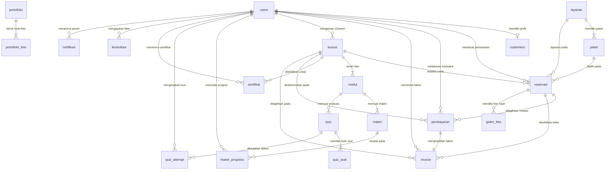

# Dokumentasi Perancangan Database — RanggaMotret.id

Dokumen ini berisi rancangan fisik basis data (*Database Schema*) yang digunakan pada sistem informasi layanan jasa fotografi dan akademi online **RanggaMotret.id**. Struktur dirancang berbasis MySQL / MariaDB dengan dukungan arsitektur MVC (Model-View-Controller) serta integritas relasional (*referential integrity*) yang utuh.

## Daftar Isi Perancangan Basis Data

- [Daftar Tabel Basis Data (21 Tabel)](#daftar-tabel-basis-data)
- [Relasi Antar Tabel (Entity-Relationship)](#relasi-antar-tabel-entity-relationship)
  - [1. Diagram Relasi Entitas (ERD)](#1-diagram-relasi-entitas-entity-relationship-diagram--erd)
  - [2. Matriks Relasi Antar Tabel (Foreign Key References)](#2-matriks-relasi-antar-tabel-foreign-key-references-matrix)
  - [3. Kluster Domain Relasi Bisnis](#3-kluster-domain-relasi-bisnis)
- [Rincian Fisik Tabel Basis Data](#rincian-fisik-tabel-basis-data)

---

## Daftar Tabel Basis Data

1. [users](#1-tabel-users) — Entitas akun pengguna (Owner & Pelanggan)
2. [customers](#2-tabel-customers) — Profil detail pelanggan
3. [layanan](#3-tabel-layanan) — Katalog layanan fotografi studio
4. [kategori_layanan](#4-tabel-kategori_layanan) — Master kategori tema layanan pemotretan
5. [paket](#5-tabel-paket) — Paket harga dan fasilitas layanan foto
6. [reservasi](#6-tabel-reservasi) — Reservasi terpadu (sesi pemotretan & pendaftaran kursus)
7. [pembayaran](#7-tabel-pembayaran) — Transaksi keuangan & integrasi Midtrans Snap
8. [invoice](#8-tabel-invoice) — Faktur tagihan resmi (pelunasan)
9. [kursus](#9-tabel-kursus) — Akademi & kursus fotografi
10. [modul](#10-tabel-modul) — Modul bab silabus kursus
11. [materi](#11-tabel-materi) — Materi pembelajaran (video/dokumen/teks)
12. [materi_progress](#12-tabel-materi_progress) — Riwayat progres belajar siswa
13. [quiz](#13-tabel-quiz) — Kuis evaluasi pemahaman modul
14. [quiz_soal](#14-tabel-quiz_soal) — Bank soal pilihan ganda kuis
15. [quiz_attempt](#15-tabel-quiz_attempt) — Hasil riwayat pengerjaan kuis siswa
16. [sertifikat](#16-tabel-sertifikat) — Sertifikat kelulusan digital & verifikasi
17. [portofolio](#17-tabel-portofolio) — Galeri album karya fotografi
18. [portofolio_foto](#18-tabel-portofolio_foto) — Rincian multi-foto dalam album karya
19. [galeri_foto](#19-tabel-galeri_foto) — Galeri foto hasil sesi klien (proofing)
20. [konsultasi](#20-tabel-konsultasi) — Tiket konsultasi konsep foto klien
21. [notifikasi](#21-tabel-notifikasi) — Notifikasi sistem real-time internal

---

## Relasi Antar Tabel (Entity-Relationship)

Bagian ini menyajikan arsitektur relasi antar tabel (*Entity-Relationship*) pada basis data **RanggaMotret.id**, yang mencakup visualisasi diagram relasi entitas (*ERD*), matriks rujukan kunci asing (*Foreign Key Constraints*), kardinalitas (*multiplicity*), aturan integritas referensial (*referential integrity actions*), serta pengelompokan domain bisnis relasional.

### 1. Diagram Relasi Entitas (Entity-Relationship Diagram / ERD)

---

### 2. Matriks Relasi Antar Tabel (Foreign Key References Matrix)

Berikut adalah tabel matriks integritas relasi fisik basis data (*Foreign Key Constraints*) yang aktif pada seluruh entitas sistem:

| No | Tabel Asal (Child Table) | Kolom Foreign Key | Tabel Tujuan (Parent Table) | Kolom Primary Key | Kardinalitas | On Delete | On Update | Deskripsi Relasi Bisnis |
| :---: | :--- | :--- | :--- | :--- | :---: | :---: | :---: | :--- |
| 1 | `customers` | `user_id` | `users` | `id` | 1 : 1 | CASCADE | RESTRICT | Relasi profil detail pelanggan dengan akun pengguna autentikasi sistem. |
| 2 | `paket` | `layanan_id` | `layanan` | `id` | 1 : N | CASCADE | RESTRICT | Penetapan paket spesifik (harga, durasi, fasilitas) ke katalog layanan foto induk. |
| 3 | `reservasi` | `user_id` | `users` | `id` | 1 : N | CASCADE | RESTRICT | Menghubungkan pemesan sesi foto atau siswa kursus ke akun pengguna sistem. |
| 4 | `reservasi` | `layanan_id` | `layanan` | `id` | 1 : N | CASCADE | RESTRICT | Menghubungkan sesi foto yang dipesan ke kategori katalog layanan foto (nullable pada kursus). |
| 5 | `reservasi` | `paket_id` | `paket` | `id` | 1 : N | CASCADE | RESTRICT | Menghubungkan sesi foto ke rincian paket penawaran yang dipilih (nullable pada kursus). |
| 6 | `reservasi` | `kursus_id` | `kursus` | `id` | 1 : N | CASCADE | RESTRICT | Menghubungkan pendaftaran kelas akademi ke program kursus yang diikuti (nullable pada foto). |
| 7 | `pembayaran` | `user_id` | `users` | `id` | 1 : N | CASCADE | RESTRICT | Menghubungkan transaksi pembayaran ke akun pembayar (pelanggan/siswa). |
| 8 | `pembayaran` | `reservasi_id` | `reservasi` | `id` | 1 : N | CASCADE | RESTRICT | Menghubungkan tagihan pembayaran dengan entitas reservasi foto atau kursus terkait. |
| 9 | `pembayaran` | `kursus_id` | `kursus` | `id` | 1 : N | SET NULL | RESTRICT | Referensi langsung ke program kursus pada transaksi checkout Midtrans Snap. |
| 10 | `invoice` | `pembayaran_id` | `pembayaran` | `id` | 1 : 1 | CASCADE | RESTRICT | Menghubungkan faktur kwitansi resmi digital ke record transaksi pembayaran lunas. |
| 11 | `invoice` | `user_id` | `users` | `id` | 1 : N | CASCADE | RESTRICT | Menghubungkan dokumen penagihan dan kwitansi resmi ke akun pelanggan. |
| 12 | `invoice` | `reservasi_id` | `reservasi` | `id` | 1 : N | CASCADE | RESTRICT | Menghubungkan faktur resmi dengan nomor reservasi pemesanan foto atau kelas kursus. |
| 13 | `invoice` | `kursus_id` | `kursus` | `id` | 1 : N | CASCADE | RESTRICT | Referensi program kursus pada dokumen faktur tagihan resmi (nullable pada foto). |
| 14 | `kursus` | `instruktur_id` | `users` | `id` | 1 : N | CASCADE | RESTRICT | Menetapkan Owner/Admin studio sebagai pengampu materi kursus akademi. |
| 15 | `modul` | `kursus_id` | `kursus` | `id` | 1 : N | CASCADE | RESTRICT | Pengelompokan bab-bab silabus terstruktur di bawah program kursus fotografi. |
| 16 | `materi` | `modul_id` | `modul` | `id` | 1 : N | CASCADE | RESTRICT | Pengelompokan butir materi (video pembelajaran, teks teori) ke dalam bab modul. |
| 17 | `materi_progress` | `user_id` | `users` | `id` | 1 : N | CASCADE | RESTRICT | Menghubungkan pencatatan progres penyelesaian materi ke akun siswa. |
| 18 | `materi_progress` | `materi_id` | `materi` | `id` | 1 : N | CASCADE | RESTRICT | Menandai centang selesai (*is_completed*) pada butir materi pelajaran tertentu. |
| 19 | `quiz` | `modul_id` | `modul` | `id` | 1 : N | CASCADE | RESTRICT | Menghubungkan paket ujian kuis evaluasi kompetensi ke bab modul silabus. |
| 20 | `quiz_soal` | `quiz_id` | `quiz` | `id` | 1 : N | CASCADE | RESTRICT | Menghubungkan butir-butir pertanyaan pilihan ganda ke dalam paket kuis. |
| 21 | `quiz_attempt` | `quiz_id` | `quiz` | `id` | 1 : N | CASCADE | RESTRICT | Menghubungkan riwayat sesi pengerjaan evaluasi ke paket kuis terkait. |
| 22 | `quiz_attempt` | `user_id` | `users` | `id` | 1 : N | CASCADE | RESTRICT | Menghubungkan perolehan skor nilai dan status kelulusan kuis ke akun siswa. |
| 23 | `sertifikat` | `user_id` | `users` | `id` | 1 : N | CASCADE | RESTRICT | Menghubungkan sertifikat digital kelulusan ke akun siswa yang berhasil menuntaskan modul. |
| 24 | `sertifikat` | `kursus_id` | `kursus` | `id` | 1 : N | CASCADE | RESTRICT | Menghubungkan sertifikat digital dengan program kursus yang telah diselesaikan. |
| 25 | `portofolio_foto` | `portofolio_id` | `portofolio` | `id` | 1 : N | CASCADE | RESTRICT | Menghubungkan koleksi multi-foto ke dalam album karya portofolio studio. |
| 26 | `galeri_foto` | `reservasi_id` | `reservasi` | `id` | 1 : N | CASCADE | RESTRICT | Menghubungkan berkas foto hasil pemotretan ke pesanan reservasi klien untuk proofing. |
| 27 | `konsultasi` | `user_id` | `users` | `id` | 1 : N | CASCADE | RESTRICT | Menghubungkan tiket konsultasi konsep foto ke akun pengguna pemohon (nullable jika tamu). |
| 28 | `notifikasi` | `user_id` | `users` | `id` | 1 : N | CASCADE | RESTRICT | Menghubungkan pemberitahuan sistem real-time in-app ke akun pengguna penerima. |

---

### 3. Kluster Domain Relasi Bisnis

Seluruh relasi fisik di atas terbagi ke dalam 6 (enam) domain fungsional yang saling terintegrasi:

1. **Domain Autentikasi & Akun Pengguna:**
   - Tabel `users` bertindak sebagai sentral identitas bagi Owner (`role: admin`) dan Pelanggan/Siswa (`role: customer` / `role: peserta`).
   - Setiap pengguna memiliki relasi 1:1 opsional dengan `customers` untuk data alamat domisili dan nomor WhatsApp, serta relasi 1:N dengan `notifikasi` untuk pesan sistem real-time.

2. **Domain Katalog Layanan Fotografi:**
   - Hubungan bertingkat antara `layanan` (induk layanan) dengan `paket` (1:N), di mana satu jenis layanan seperti *Wedding Photography* memayungi paket *Silver*, *Gold Cinematic*, dan *Platinum*.
   - Tabel `kategori_layanan` menyediakan master klasifikasi tema untuk memfilter katalog dan portofolio secara konsisten.

3. **Domain Pemesanan & Reservasi Terpadu:**
   - Menggunakan tabel tunggal `reservasi` sebagai entitas terpadu untuk pemesanan pemotretan (`tipe = 'fotografi'`) maupun pendaftaran kursus akademi (`tipe = 'kursus'`).
   - Sesi foto terhubung dengan `galeri_foto` (1:N) untuk proses *photo proofing*, pemilihan foto cetak album (`is_selected`), dan pemberian revisi retouching oleh klien.
   - Calon klien juga dapat mengajukan pra-reservasi melalui tiket `konsultasi`.

4. **Domain Transaksi Finansial & Faktur:**
   - Tabel `pembayaran` mencatat transaksi pembayaran online instan via Midtrans Snap Payment Gateway (QRIS, GoPay, Virtual Account, Credit Card) dengan relasi N:1 ke `reservasi` dan `users`.
   - Setiap pembayaran yang terverifikasi `Lunas / Dibayar` secara otomatis menerbitkan satu record resmi pada tabel `invoice` (relasi 1:1 dengan `pembayaran`) lengkap dengan nomor seri faktur unik (`nomor_invoice`) sebagai bukti sah pembukuan studio.

5. **Domain LMS & Edukasi Fotografi:**
   - Terstruktur secara hierarkis: `kursus` &rarr; `modul` (1:N) &rarr; `materi` (1:N) dan `quiz` (1:N) &rarr; `quiz_soal` (1:N).
   - Aktivitas siswa dipantau melalui `materi_progress` (progres centang materi) dan `quiz_attempt` (evaluasi nilai ujian).
   - Siswa yang berhasil menyelesaikan seluruh modul dan mencapai batas kelulusan berhak menerima `sertifikat` digital ber-barcode unik (`kode_verifikasi`).

6. **Domain Showcase Portofolio:**
   - Terdiri dari `portofolio` (album karya) yang memiliki relasi 1:N dengan `portofolio_foto` untuk menampilkan galeri multi-foto karya terbaik studio RanggaMotret kepada calon klien.

---

## Rincian Fisik Tabel Basis Data

### 1. Tabel: `users`
- **Nama Tabel:** `users`
- **Primary Key:** `id`
- **Foreign Key:** Tidak ada
- **Deskripsi Tabel:** Menyimpan data kredensial akun pengguna sistem, baik akun Administrator/Owner (`role: admin`) maupun akun Pelanggan/Klien/Peserta Kursus (`role: customer`).

| Field | Type | Size | Keterangan |
| :--- | :--- | :--- | :--- |
| `id` | BIGINT (UNSIGNED) | 20 | Identifikator unik akun pengguna (Primary Key, Auto Increment) |
| `name` | VARCHAR | 255 | Nama lengkap pengguna |
| `email` | VARCHAR | 255 | Alamat email unik untuk otentikasi login (Unique) |
| `email_verified_at` | TIMESTAMP | - | Waktu verifikasi email (Nullable) |
| `password` | VARCHAR | 255 | Kata sandi pengguna yang telah dienkripsi (Hash bcrypt/argon2) |
| `role` | VARCHAR | 50 | Peran akses sistem ('admin' = Owner, 'customer' = Pelanggan) |
| `status` | VARCHAR | 20 | Status akun pengguna ('active', 'inactive') |
| `phone` | VARCHAR | 20 | Nomor telepon / WhatsApp pengguna (Nullable) |
| `address` | TEXT | - | Alamat tempat tinggal / domisili pengguna (Nullable) |
| `avatar` | VARCHAR | 255 | Path atau URL berkas foto profil pengguna (Nullable) |
| `remember_token` | VARCHAR | 100 | Token penyimpanan sesi masuk otomatis (Nullable) |
| `created_at` | TIMESTAMP | - | Waktu data akun dibuat |
| `updated_at` | TIMESTAMP | - | Waktu data akun terakhir diperbarui |

---

### 2. Tabel: `customers`
- **Nama Tabel:** `customers`
- **Primary Key:** `id`
- **Foreign Key:** `user_id` (mengacu ke `users.id` dengan relasi `ON DELETE CASCADE`)
- **Deskripsi Tabel:** Menyimpan data pelengkap profil khusus untuk entitas pelanggan/klien pemesan sesi foto dan peserta kursus.

| Field | Type | Size | Keterangan |
| :--- | :--- | :--- | :--- |
| `id` | BIGINT (UNSIGNED) | 20 | Identifikator unik record customer (Primary Key, Auto Increment) |
| `user_id` | BIGINT (UNSIGNED) | 20 | Foreign Key mengacu ke `users.id` |
| `phone` | VARCHAR | 20 | Nomor kontak telepon / WhatsApp aktif (Nullable) |
| `address` | TEXT | - | Alamat domisili lengkap pelanggan (Nullable) |
| `bio` | TEXT | - | Deskripsi ringkas profil pelanggan (Nullable) |
| `created_at` | TIMESTAMP | - | Waktu data profil dibuat |
| `updated_at` | TIMESTAMP | - | Waktu data profil terakhir diperbarui |

---

### 3. Tabel: `layanan`
- **Nama Tabel:** `layanan`
- **Primary Key:** `id`
- **Foreign Key:** Tidak ada
- **Deskripsi Tabel:** Menyimpan katalog induk jenis layanan jasa fotografi yang disediakan oleh studio RanggaMotret (misal: Wedding, Prewedding, Wisuda, Studio Portrait).

| Field | Type | Size | Keterangan |
| :--- | :--- | :--- | :--- |
| `id` | BIGINT (UNSIGNED) | 20 | Identifikator unik jenis layanan (Primary Key, Auto Increment) |
| `nama` | VARCHAR | 255 | Nama layanan fotografi |
| `kategori` | VARCHAR | 100 | Kategori layanan pemotretan |
| `deskripsi` | TEXT | - | Uraian penjelasan deskriptif layanan (Nullable) |
| `harga_mulai` | DECIMAL | 12,2 | Estimasi harga awal penawaran layanan (Rp) |
| `thumbnail` | VARCHAR | 255 | Path atau URL gambar banner sampul layanan (Nullable) |
| `status` | VARCHAR | 20 | Status ketersediaan layanan ('aktif', 'nonaktif') |
| `created_at` | TIMESTAMP | - | Waktu data layanan dibuat |
| `updated_at` | TIMESTAMP | - | Waktu data layanan terakhir diperbarui |

---

### 4. Tabel: `kategori_layanan`
- **Nama Tabel:** `kategori_layanan`
- **Primary Key:** `id`
- **Foreign Key:** Tidak ada
- **Deskripsi Tabel:** Menyimpan daftar master kategori untuk pengelompokan layanan fotografi serta mempermudah filtering portofolio dan pemesanan.

| Field | Type | Size | Keterangan |
| :--- | :--- | :--- | :--- |
| `id` | BIGINT (UNSIGNED) | 20 | Identifikator unik kategori (Primary Key, Auto Increment) |
| `nama` | VARCHAR | 100 | Nama kategori layanan (Unique) |
| `slug` | VARCHAR | 100 | Slug URL ramah SEO (Unique) |
| `icon` | VARCHAR | 50 | Nama identifier icon (Phosphor Icons / FontAwesome) |
| `deskripsi` | TEXT | - | Penjelasan singkat cakupan kategori (Nullable) |
| `status` | VARCHAR | 20 | Status operasional kategori ('aktif', 'nonaktif') |
| `created_at` | TIMESTAMP | - | Waktu data kategori dibuat |
| `updated_at` | TIMESTAMP | - | Waktu data kategori terakhir diperbarui |

---

### 5. Tabel: `paket`
- **Nama Tabel:** `paket`
- **Primary Key:** `id`
- **Foreign Key:** `layanan_id` (mengacu ke `layanan.id` dengan relasi `ON DELETE CASCADE`)
- **Deskripsi Tabel:** Menyimpan paket-paket spesifik yang ditawarkan di bawah suatu layanan fotografi, lengkap dengan rincian harga, durasi, dan fasilitas.

| Field | Type | Size | Keterangan |
| :--- | :--- | :--- | :--- |
| `id` | BIGINT (UNSIGNED) | 20 | Identifikator unik paket (Primary Key, Auto Increment) |
| `layanan_id` | BIGINT (UNSIGNED) | 20 | Foreign Key mengacu ke `layanan.id` |
| `nama_paket` | VARCHAR | 255 | Nama paket penawaran (e.g. Bronze, Silver, Premium) |
| `harga` | DECIMAL | 12,2 | Tarif harga resmi paket fotografi (Rp) |
| `durasi` | VARCHAR | 50 | Estimasi alokasi waktu pemotretan (e.g. "2 Jam", "Full Day") |
| `jumlah_fotografer` | INT | 11 | Jumlah fotografer yang bertugas di lapangan |
| `jumlah_foto` | INT | 11 | Jumlah file foto jadi yang diterima klien |
| `fasilitas` | TEXT | - | Rincian fasilitas, cetak album, frame, dsb (Nullable) |
| `deskripsi` | TEXT | - | Penjelasan detail ketentuan paket (Nullable) |
| `status` | VARCHAR | 20 | Status penjualan paket ('aktif', 'nonaktif') |
| `created_at` | TIMESTAMP | - | Waktu paket didaftarkan |
| `updated_at` | TIMESTAMP | - | Waktu data paket diperbarui |

---

### 6. Tabel: `reservasi`
- **Nama Tabel:** `reservasi`
- **Primary Key:** `id`
- **Foreign Key:** 
  - `user_id` (mengacu ke `users.id` dengan relasi `ON DELETE CASCADE`)
  - `layanan_id` (mengacu ke `layanan.id` dengan relasi `ON DELETE CASCADE`, Nullable)
  - `paket_id` (mengacu ke `paket.id` dengan relasi `ON DELETE CASCADE`, Nullable)
  - `kursus_id` (mengacu ke `kursus.id` dengan relasi `ON DELETE CASCADE`, Nullable)
- **Deskripsi Tabel:** Menyimpan rekaman transaksi reservasi terpadu baik untuk sesi pemotretan studio maupun pendaftaran kursus akademi oleh pelanggan/siswa, meliputi tipe reservasi, jadwal, lokasi, dan status operasional.

| Field | Type | Size | Keterangan |
| :--- | :--- | :--- | :--- |
| `id` | BIGINT (UNSIGNED) | 20 | Identifikator unik reservasi (Primary Key, Auto Increment) |
| `nomor_reservasi` | VARCHAR | 50 | Kode reservasi unik pemesanan (Unique, e.g. RSV-20261025-001) |
| `tipe` | ENUM | ('fotografi','kursus') | Klasifikasi pemesanan ('fotografi' = Sesi Foto, 'kursus' = Pendaftaran Kursus) |
| `user_id` | BIGINT (UNSIGNED) | 20 | Foreign Key pelanggan/siswa pemesan (`users.id`) |
| `layanan_id` | BIGINT (UNSIGNED) | 20 | Foreign Key layanan fotografi yang dipesan (`layanan.id`, Nullable) |
| `paket_id` | BIGINT (UNSIGNED) | 20 | Foreign Key paket foto yang dipilih (`paket.id`, Nullable) |
| `kursus_id` | BIGINT (UNSIGNED) | 20 | Foreign Key kursus akademi yang didaftar (`kursus.id`, Nullable) |
| `tanggal` | DATE | - | Tanggal sesi pemotretan / tanggal mulai kelas (Nullable) |
| `waktu` | TIME | - | Jam dimulainya sesi pemotretan (Nullable) |
| `lokasi` | VARCHAR | 255 | Tempat/venue pemotretan atau 'Online Classroom LMS' (Nullable) |
| `kebutuhan_khusus` | TEXT | - | Catatan permintaan khusus dari klien/siswa (Nullable) |
| `status` | VARCHAR | 50 | Status proses reservasi ('Menunggu Konfirmasi', 'Disetujui', 'Ditolak', 'Menunggu Pembayaran', 'Dibayar', 'Terjadwal', 'Selesai', 'Dibatalkan') |
| `created_at` | TIMESTAMP | - | Waktu reservasi diajukan |
| `updated_at` | TIMESTAMP | - | Waktu status reservasi diperbarui |

---

### 7. Tabel: `pembayaran`
- **Nama Tabel:** `pembayaran`
- **Primary Key:** `id`
- **Foreign Key:** 
  - `user_id` (mengacu ke `users.id` dengan relasi `ON DELETE CASCADE`)
  - `reservasi_id` (mengacu ke `reservasi.id` dengan relasi `ON DELETE CASCADE`, Nullable)
  - `kursus_id` (mengacu ke `kursus.id` dengan relasi `ON DELETE SET NULL`, Nullable)
- **Deskripsi Tabel:** Menyimpan data transaksi finansial untuk tagihan reservasi pemotretan maupun pendaftaran kelas kursus fotografi, terintegrasi dengan Payment Gateway Midtrans.

| Field | Type | Size | Keterangan |
| :--- | :--- | :--- | :--- |
| `id` | BIGINT (UNSIGNED) | 20 | Identifikator unik pembayaran (Primary Key, Auto Increment) |
| `nomor_transaksi` | VARCHAR | 50 | Nomor transaksi unik (Unique, e.g. TRX-20261025-001) |
| `user_id` | BIGINT (UNSIGNED) | 20 | Foreign Key pembayar (`users.id`) |
| `reservasi_id` | BIGINT (UNSIGNED) | 20 | Foreign Key referensi reservasi terpadu (`reservasi.id`, Nullable) |
| `kursus_id` | BIGINT (UNSIGNED) | 20 | Foreign Key referensi kursus (`kursus.id`, Nullable) |
| `jumlah` | DECIMAL | 12,2 | Total nominal uang pembayaran (Rp) |
| `metode_pembayaran` | VARCHAR | 100 | Saluran bayar online Midtrans Snap (QRIS, VA, E-Wallet, CC) |
| `tanggal_pembayaran` | TIMESTAMP | - | Waktu penyelesaian pembayaran (Nullable) |
| `catatan` | TEXT | - | Catatan keterangan transaksi (Nullable) |
| `status` | VARCHAR | 50 | Status pembayaran ('Belum Dibayar', 'Menunggu Pembayaran', 'Dibayar', 'Ditolak', 'Dibatalkan') |
| `snap_token` | VARCHAR | 255 | Token transaksi Midtrans Snap untuk popup checkout (Nullable) |
| `payment_type` | VARCHAR | 50 | Jenis metode bayar Midtrans (qris, bank_transfer, dll) (Nullable) |
| `payload_response` | JSON | - | Payload utuh respon callback webhook Midtrans (Nullable) |
| `created_at` | TIMESTAMP | - | Waktu data transaksi dibuat |
| `updated_at` | TIMESTAMP | - | Waktu data transaksi terakhir diperbarui |

---

### 8. Tabel: `invoice`
- **Nama Tabel:** `invoice`
- **Primary Key:** `id`
- **Foreign Key:** 
  - `pembayaran_id` (mengacu ke `pembayaran.id` dengan relasi `ON DELETE CASCADE`)
  - `user_id` (mengacu ke `users.id` dengan relasi `ON DELETE CASCADE`)
  - `reservasi_id` (mengacu ke `reservasi.id` dengan relasi `ON DELETE CASCADE`, Nullable)
  - `kursus_id` (mengacu ke `kursus.id` dengan relasi `ON DELETE CASCADE`, Nullable)
- **Deskripsi Tabel:** Menyimpan faktur resmi digital sebagai bukti penagihan dan kwitansi pelunasan untuk keperluan pembukuan studio dan arsip pelanggan.

| Field | Type | Size | Keterangan |
| :--- | :--- | :--- | :--- |
| `id` | BIGINT (UNSIGNED) | 20 | Identifikator unik faktur (Primary Key, Auto Increment) |
| `nomor_invoice` | VARCHAR | 50 | Kode seri faktur unik (Unique, e.g. INV-20261025-001) |
| `pembayaran_id` | BIGINT (UNSIGNED) | 20 | Foreign Key transaksi pelunasan (`pembayaran.id`) |
| `user_id` | BIGINT (UNSIGNED) | 20 | Foreign Key pihak pembayar (`users.id`) |
| `reservasi_id` | BIGINT (UNSIGNED) | 20 | Foreign Key reservasi terkait (`reservasi.id`, Nullable) |
| `kursus_id` | BIGINT (UNSIGNED) | 20 | Foreign Key pendaftaran kursus terkait (`kursus.id`, Nullable) |
| `subtotal` | DECIMAL | 12,2 | Jumlah biaya kotor sebelum potongan diskon |
| `diskon` | DECIMAL | 12,2 | Potongan harga kupon promo (Default 0) |
| `total` | DECIMAL | 12,2 | Nilai akhir tagihan yang wajib dibayarkan (Rp) |
| `status_pembayaran` | VARCHAR | 30 | Status tagihan ('LUNAS', 'PENDING') |
| `created_at` | TIMESTAMP | - | Waktu penerbitan faktur |
| `updated_at` | TIMESTAMP | - | Waktu pembaruan data faktur |

---

### 9. Tabel: `kursus`
- **Nama Tabel:** `kursus`
- **Primary Key:** `id`
- **Foreign Key:** `instruktur_id` (mengacu ke `users.id` dengan relasi `ON DELETE CASCADE`)
- **Deskripsi Tabel:** Menyimpan data paket kursus fotografi pada platform LMS (Learning Management System) RanggaMotret.

| Field | Type | Size | Keterangan |
| :--- | :--- | :--- | :--- |
| `id` | BIGINT (UNSIGNED) | 20 | Identifikator unik kursus (Primary Key, Auto Increment) |
| `nama` | VARCHAR | 255 | Judul program kursus fotografi |
| `deskripsi` | TEXT | - | Penjelasan silabus dan capaian kursus (Nullable) |
| `harga` | DECIMAL | 12,2 | Biaya keikutsertaan kursus (Rp) |
| `durasi` | VARCHAR | 50 | Estimasi durasi pembelajaran (e.g. "4 Minggu", "12 Jam") |
| `level` | VARCHAR | 50 | Tingkat keahlian ('Pemula', 'Menengah', 'Mahir') |
| `instruktur_id` | BIGINT (UNSIGNED) | 20 | Foreign Key pengajar/instruktur penanggung jawab (`users.id`) |
| `thumbnail` | VARCHAR | 255 | Path atau URL gambar sampul poster kursus (Nullable) |
| `status` | VARCHAR | 20 | Status ketersediaan kursus ('aktif', 'draft') |
| `created_at` | TIMESTAMP | - | Waktu kursus didaftarkan |
| `updated_at` | TIMESTAMP | - | Waktu data kursus diperbarui |

---

### 10. Tabel: `modul`
- **Nama Tabel:** `modul`
- **Primary Key:** `id`
- **Foreign Key:** `kursus_id` (mengacu ke `kursus.id` dengan relasi `ON DELETE CASCADE`)
- **Deskripsi Tabel:** Menyimpan daftar modul (bab/kurikulum silabus) yang terorganisir di dalam suatu kursus fotografi.

| Field | Type | Size | Keterangan |
| :--- | :--- | :--- | :--- |
| `id` | BIGINT (UNSIGNED) | 20 | Identifikator unik modul (Primary Key, Auto Increment) |
| `kursus_id` | BIGINT (UNSIGNED) | 20 | Foreign Key referensi kursus induk (`kursus.id`) |
| `judul` | VARCHAR | 255 | Judul bab/modul pembelajaran |
| `urutan` | INT | 11 | Nomor urutan susunan bab silabus (Default 1) |
| `deskripsi` | TEXT | - | Ringkasan materi yang dibahas dalam bab (Nullable) |
| `created_at` | TIMESTAMP | - | Waktu modul dibuat |
| `updated_at` | TIMESTAMP | - | Waktu modul diperbarui |

---

### 11. Tabel: `materi`
- **Nama Tabel:** `materi`
- **Primary Key:** `id`
- **Foreign Key:** `modul_id` (mengacu ke `modul.id` dengan relasi `ON DELETE CASCADE`)
- **Deskripsi Tabel:** Menyimpan rincian konten pembelajaran per materi di dalam modul, dapat berupa video embed, dokumen PDF unduhan, maupun teks artikel.

| Field | Type | Size | Keterangan |
| :--- | :--- | :--- | :--- |
| `id` | BIGINT (UNSIGNED) | 20 | Identifikator unik materi (Primary Key, Auto Increment) |
| `modul_id` | BIGINT (UNSIGNED) | 20 | Foreign Key referensi modul induk (`modul.id`) |
| `judul` | VARCHAR | 255 | Judul materi sesi pembelajaran |
| `tipe` | VARCHAR | 20 | Format materi ('teks', 'pdf', 'foto', 'video', 'link') |
| `file_path` | VARCHAR | 255 | Path berkas lampiran pendukung materi (Nullable) |
| `video_url` | VARCHAR | 255 | URL video pembelajaran YouTube / Vimeo embed (Nullable) |
| `isi` | LONGTEXT | - | Isi lengkap teks penjelasan materi (Nullable) |
| `urutan` | INT | 11 | Nomor urut pemutaran materi dalam bab (Default 1) |
| `created_at` | TIMESTAMP | - | Waktu materi ditambahkan |
| `updated_at` | TIMESTAMP | - | Waktu materi terakhir disunting |

---

### 12. Tabel: `materi_progress`
- **Nama Tabel:** `materi_progress`
- **Primary Key:** `id`
- **Foreign Key:** 
  - `user_id` (mengacu ke `users.id` dengan relasi `ON DELETE CASCADE`)
  - `materi_id` (mengacu ke `materi.id` dengan relasi `ON DELETE CASCADE`)
- **Deskripsi Tabel:** Mencatat jejak progres belajar setiap siswa terhadap tiap-tiap materi pembelajaran untuk mengkalkulasi persentase kelulusan (0-100%).

| Field | Type | Size | Keterangan |
| :--- | :--- | :--- | :--- |
| `id` | BIGINT (UNSIGNED) | 20 | Identifikator unik data progres (Primary Key, Auto Increment) |
| `user_id` | BIGINT (UNSIGNED) | 20 | Foreign Key akun siswa (`users.id`) |
| `materi_id` | BIGINT (UNSIGNED) | 20 | Foreign Key materi yang dipelajari (`materi.id`) |
| `is_completed` | TINYINT (BOOLEAN) | 1 | Status penyelesaian materi (1 = Selesai, 0 = Belum) |
| `created_at` | TIMESTAMP | - | Waktu pertama kali materi dibuka |
| `updated_at` | TIMESTAMP | - | Waktu materi ditandai telah selesai |

---

### 13. Tabel: `quiz`
- **Nama Tabel:** `quiz`
- **Primary Key:** `id`
- **Foreign Key:** `modul_id` (mengacu ke `modul.id` dengan relasi `ON DELETE CASCADE`)
- **Deskripsi Tabel:** Menyimpan kuis evaluasi pemahaman teori dasar fotografi di setiap modul pembelajaran.

| Field | Type | Size | Keterangan |
| :--- | :--- | :--- | :--- |
| `id` | BIGINT (UNSIGNED) | 20 | Identifikator unik kuis (Primary Key, Auto Increment) |
| `modul_id` | BIGINT (UNSIGNED) | 20 | Foreign Key referensi modul (`modul.id`) |
| `judul` | VARCHAR | 255 | Judul sesi kuis evaluasi |
| `durasi_menit` | INT | 11 | Alokasi waktu pengerjaan kuis dalam menit (Default 30) |
| `passing_grade` | INT | 11 | Nilai ambang batas minimum kelulusan kuis (Default 70) |
| `created_at` | TIMESTAMP | - | Waktu kuis dibuat |
| `updated_at` | TIMESTAMP | - | Waktu data kuis diperbarui |

---

### 14. Tabel: `quiz_soal`
- **Nama Tabel:** `quiz_soal`
- **Primary Key:** `id`
- **Foreign Key:** `quiz_id` (mengacu ke `quiz.id` dengan relasi `ON DELETE CASCADE`)
- **Deskripsi Tabel:** Menyimpan butir-butir pertanyaan pilihan ganda beserta opsi pilihan jawaban dan kunci jawaban yang benar.

| Field | Type | Size | Keterangan |
| :--- | :--- | :--- | :--- |
| `id` | BIGINT (UNSIGNED) | 20 | Identifikator unik butir soal (Primary Key, Auto Increment) |
| `quiz_id` | BIGINT (UNSIGNED) | 20 | Foreign Key referensi kuis induk (`quiz.id`) |
| `pertanyaan` | TEXT | - | Teks naskah pertanyaan kuis |
| `pilihan_a` | VARCHAR | 255 | Pilihan teks jawaban opsi A |
| `pilihan_b` | VARCHAR | 255 | Pilihan teks jawaban opsi B |
| `pilihan_c` | VARCHAR | 255 | Pilihan teks jawaban opsi C |
| `pilihan_d` | VARCHAR | 255 | Pilihan teks jawaban opsi D |
| `jawaban_benar` | ENUM | ('A','B','C','D') | Kunci pilihan jawaban yang bernilai benar |
| `pembahasan` | TEXT | - | Penjelasan teori dari jawaban yang benar (Nullable) |
| `bobot_nilai` | INT | 11 | Nilai poin jika dijawab dengan benar (Default 10) |
| `created_at` | TIMESTAMP | - | Waktu soal dibuat |
| `updated_at` | TIMESTAMP | - | Waktu soal diperbarui |

---

### 15. Tabel: `quiz_attempt`
- **Nama Tabel:** `quiz_attempt`
- **Primary Key:** `id`
- **Foreign Key:** 
  - `quiz_id` (mengacu ke `quiz.id` dengan relasi `ON DELETE CASCADE`)
  - `user_id` (mengacu ke `users.id` dengan relasi `ON DELETE CASCADE`)
- **Deskripsi Tabel:** Menyimpan rekaman riwayat percobaan pengerjaan kuis oleh siswa beserta nilai skor akhir dan status kelulusan.

| Field | Type | Size | Keterangan |
| :--- | :--- | :--- | :--- |
| `id` | BIGINT (UNSIGNED) | 20 | Identifikator unik sesi pengerjaan (Primary Key, Auto Increment) |
| `quiz_id` | BIGINT (UNSIGNED) | 20 | Foreign Key kuis yang dikerjakan (`quiz.id`) |
| `user_id` | BIGINT (UNSIGNED) | 20 | Foreign Key akun siswa pengerja (`users.id`) |
| `nilai` | INT | 11 | Skor perolehan nilai akhir kuis |
| `is_passed` | TINYINT (BOOLEAN) | 1 | Status kelulusan (1 = Lulus, 0 = Belum Lulus) |
| `created_at` | TIMESTAMP | - | Waktu mulai pengerjaan kuis |
| `updated_at` | TIMESTAMP | - | Waktu selesai evaluasi kuis |

---

### 16. Tabel: `sertifikat`
- **Nama Tabel:** `sertifikat`
- **Primary Key:** `id`
- **Foreign Key:** 
  - `user_id` (mengacu ke `users.id` dengan relasi `ON DELETE CASCADE`)
  - `kursus_id` (mengacu ke `kursus.id` dengan relasi `ON DELETE CASCADE`)
- **Deskripsi Tabel:** Menyimpan sertifikat kelulusan digital yang diterbitkan otomatis bagi siswa yang telah menyelesaikan seluruh modul kursus.

| Field | Type | Size | Keterangan |
| :--- | :--- | :--- | :--- |
| `id` | BIGINT (UNSIGNED) | 20 | Identifikator unik sertifikat (Primary Key, Auto Increment) |
| `user_id` | BIGINT (UNSIGNED) | 20 | Foreign Key penerima sertifikat (`users.id`) |
| `kursus_id` | BIGINT (UNSIGNED) | 20 | Foreign Key kursus yang diselesaikan (`kursus.id`) |
| `nomor_sertifikat` | VARCHAR | 100 | Nomor seri resmi sertifikat (Unique, e.g. CERT-RM-2026-0001) |
| `kode_verifikasi` | VARCHAR | 100 | Kode keamanan unik untuk validasi keaslian publik (Unique) |
| `tanggal_terbit` | DATE | - | Tanggal resmi penerbitan sertifikat |
| `nilai_akhir` | DECIMAL | 5,2 | Nilai rata-rata akumulatif kelulusan siswa |
| `created_at` | TIMESTAMP | - | Waktu sertifikat di-generate sistem |
| `updated_at` | TIMESTAMP | - | Waktu pembaruan data sertifikat |

---

### 17. Tabel: `portofolio`
- **Nama Tabel:** `portofolio`
- **Primary Key:** `id`
- **Foreign Key:** Tidak ada
- **Deskripsi Tabel:** Menyimpan data induk album galeri karya fotografi karya fotografer RanggaMotret untuk dipamerkan kepada calon klien.

| Field | Type | Size | Keterangan |
| :--- | :--- | :--- | :--- |
| `id` | BIGINT (UNSIGNED) | 20 | Identifikator unik album karya (Primary Key, Auto Increment) |
| `judul` | VARCHAR | 255 | Judul album portofolio karya foto |
| `kategori` | VARCHAR | 100 | Klasifikasi kategori karya foto (Wedding, Portrait, dll) |
| `foto` | VARCHAR | 255 | Path atau URL berkas foto sampul album utama |
| `deskripsi` | TEXT | - | Cerita konsep visual dan arahan gaya karya (Nullable) |
| `tanggal` | DATE | - | Tanggal sesi pemotretan karya berlangsung (Nullable) |
| `status_publikasi` | VARCHAR | 20 | Status penayangan ('published', 'draft', 'archived') |
| `created_at` | TIMESTAMP | - | Waktu album dibuat |
| `updated_at` | TIMESTAMP | - | Waktu informasi album diperbarui |

---

### 18. Tabel: `portofolio_foto`
- **Nama Tabel:** `portofolio_foto`
- **Primary Key:** `id`
- **Foreign Key:** `portofolio_id` (mengacu ke `portofolio.id` dengan relasi `ON DELETE CASCADE`)
- **Deskripsi Tabel:** Menyimpan relasi multi-foto yang ada di dalam setiap album karya portofolio.

| Field | Type | Size | Keterangan |
| :--- | :--- | :--- | :--- |
| `id` | BIGINT (UNSIGNED) | 20 | Identifikator unik foto album (Primary Key, Auto Increment) |
| `portofolio_id` | BIGINT (UNSIGNED) | 20 | Foreign Key referensi album karya (`portofolio.id`) |
| `foto` | VARCHAR | 255 | Path lokasi berkas gambar foto |
| `caption` | VARCHAR | 255 | Keterangan teks penjelas foto (Nullable) |
| `urutan` | INT | 11 | Urutan tata letak foto dalam galeri album (Default 0) |
| `created_at` | TIMESTAMP | - | Waktu foto ditambahkan ke album |
| `updated_at` | TIMESTAMP | - | Waktu data foto diperbarui |

---

### 19. Tabel: `galeri_foto`
- **Nama Tabel:** `galeri_foto`
- **Primary Key:** `id`
- **Foreign Key:** `reservasi_id` (mengacu ke `reservasi.id` dengan relasi `ON DELETE CASCADE`)
- **Deskripsi Tabel:** Menyimpan foto-foto hasil sesi pemotretan pesanan klien untuk proses seleksi (*photo proofing*), revisi retouching, dan pengunduhan hasil akhir.

| Field | Type | Size | Keterangan |
| :--- | :--- | :--- | :--- |
| `id` | BIGINT (UNSIGNED) | 20 | Identifikator unik foto hasil sesi (Primary Key, Auto Increment) |
| `reservasi_id` | BIGINT (UNSIGNED) | 20 | Foreign Key nomor pemesanan pemotretan (`reservasi.id`) |
| `foto_path` | VARCHAR | 255 | Path berkas foto pada media penyimpanan server |
| `is_selected` | TINYINT (BOOLEAN) | 1 | Penanda pilihan foto yang disukai/dipilih klien untuk dicetak (1 = Ya, 0 = Tidak) |
| `catatan` | TEXT | - | Permintaan khusus klien pada foto terkait (Nullable) |
| `created_at` | TIMESTAMP | - | Waktu foto diunggah oleh studio |
| `updated_at` | TIMESTAMP | - | Waktu pemilihan/catatan diperbarui klien |

---

### 20. Tabel: `konsultasi`
- **Nama Tabel:** `konsultasi`
- **Primary Key:** `id`
- **Foreign Key:** `user_id` (mengacu ke `users.id` dengan relasi `ON DELETE CASCADE`, Nullable)
- **Deskripsi Tabel:** Menyimpan permohonan konsultasi konsep pemotretan dari calon klien beserta tanggapan rekomendasi dari fotografer.

| Field | Type | Size | Keterangan |
| :--- | :--- | :--- | :--- |
| `id` | BIGINT (UNSIGNED) | 20 | Identifikator unik konsultasi (Primary Key, Auto Increment) |
| `user_id` | BIGINT (UNSIGNED) | 20 | Foreign Key akun pengguna penanya jika login (`users.id`, Nullable) |
| `nama` | VARCHAR | 255 | Nama lengkap calon klien pemohon |
| `email` | VARCHAR | 255 | Alamat email calon klien |
| `phone` | VARCHAR | 25 | Nomor telepon / WhatsApp calon klien |
| `jenis_layanan` | VARCHAR | 100 | Bidang fotografi yang ingin dikonsultasikan |
| `konsep` | VARCHAR | 255 | Gambaran tema konsep visual yang diinginkan (Nullable) |
| `lokasi` | VARCHAR | 255 | Rencana lokasi atau spot pemotretan (Nullable) |
| `tanggal` | DATE | - | Estimasi tanggal rencana pemotretan (Nullable) |
| `budget` | DECIMAL | 12,2 | Estimasi kesiapan anggaran dana klien (Nullable) |
| `kebutuhan` | TEXT | - | Uraian lengkap kebutuhan dan pertanyaan klien (Nullable) |
| `referensi_foto` | VARCHAR | 255 | Path atau tautan berkas foto inspirasi/moodboard (Nullable) |
| `tanggapan_admin` | TEXT | - | Jawaban dan arahan konsep resmi dari fotografer (Nullable) |
| `status` | VARCHAR | 20 | Status penanganan tiket ('pending', 'replied') |
| `created_at` | TIMESTAMP | - | Waktu pesan konsultasi dikirim klien |
| `updated_at` | TIMESTAMP | - | Waktu tanggapan admin dikirimkan |

---

### 21. Tabel: `notifikasi`
- **Nama Tabel:** `notifikasi`
- **Primary Key:** `id`
- **Foreign Key:** `user_id` (mengacu ke `users.id` dengan relasi `ON DELETE CASCADE`)
- **Deskripsi Tabel:** Menyimpan riwayat notifikasi sistem *in-app* untuk menginformasikan status pemesanan, verifikasi pembayaran, materi baru, dan tanggapan konsultasi.

| Field | Type | Size | Keterangan |
| :--- | :--- | :--- | :--- |
| `id` | BIGINT (UNSIGNED) | 20 | Identifikator unik pesan notifikasi (Primary Key, Auto Increment) |
| `user_id` | BIGINT (UNSIGNED) | 20 | Foreign Key akun pengguna penerima notifikasi (`users.id`) |
| `judul` | VARCHAR | 255 | Judul singkat subjek pemberitahuan |
| `pesan` | TEXT | - | Rincian teks isi pesan pemberitahuan |
| `link` | VARCHAR | 255 | URL tujuan redirect saat notifikasi diklik pengguna (Nullable) |
| `is_read` | TINYINT (BOOLEAN) | 1 | Status keterbacaan pesan (1 = Sudah Dibaca, 0 = Belum Dibaca) |
| `created_at` | TIMESTAMP | - | Waktu notifikasi dipicu oleh sistem |
| `updated_at` | TIMESTAMP | - | Waktu status pesan diperbarui |
